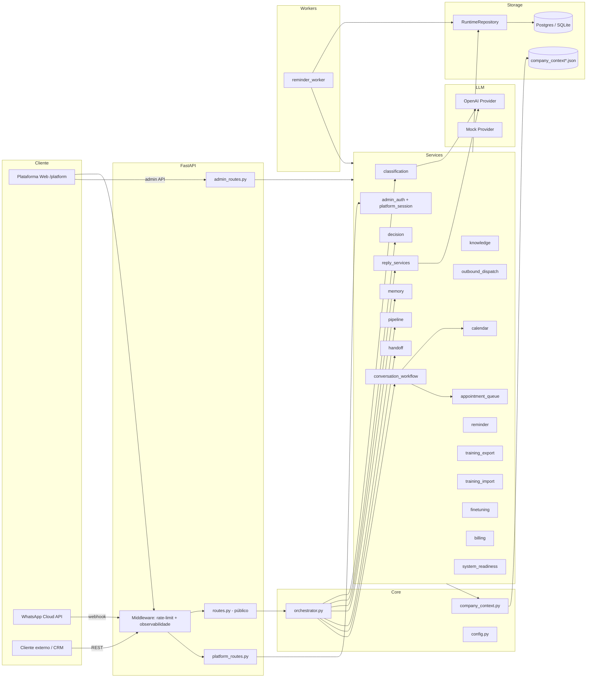
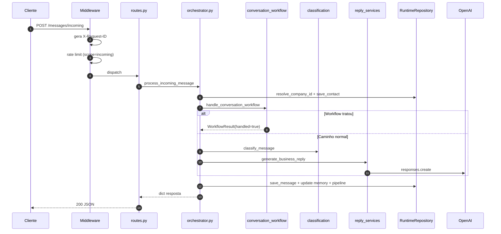

# Arquitetura em Camadas

## Diagrama macro

## As 6 camadas

### 1. Entrada HTTP

Arquivos: `app/main.py`, `app/api/routes.py`, `app/api/admin_routes.py`, `app/api/platform_routes.py`, `app/api/schemas.py`.

Responsabilidades:
- Bootstrap FastAPI + lifespan + middleware de observabilidade e rate limiting (`app/main.py:75-153`).
- Servir SPA da plataforma em `/platform` e expor login/logout/sessão.
- Validar payloads (Pydantic) e traduzir exceções em respostas HTTP.

Detalhes em [[20-Modules/02-API Pública]] e [[20-Modules/03-API Admin]].

### 2. Orquestração

Arquivo: `app/core/orchestrator.py`.

Função única `_process_contact_message()` que cobre todo o ciclo de uma mensagem:
1. Resolve `company_id` (id, slug, ou empresa default).
2. Persiste/atualiza contato.
3. Recupera memória anterior + clarificação pendente.
4. Tenta primeiro o **workflow conversacional** (agenda/cancelamento/reagendamento/operador). Se tratar, encerra ali.
5. Caso contrário: classifica → decide → gera resposta → cria pending_question se for handoff.
6. Persiste mensagem, atualiza memória + pipeline.

Sempre log estruturado com `mask_identifier(contact_id)`.

### 3. Serviços de negócio

Diretório: `app/services/` (~25 serviços). Catálogo em [[20-Modules/05-Services]].

Categorias:

- **Conversação**: `classification`, `decision`, `reply_services`, `style`, `handoff`, `memory`, `pipeline`, `knowledge`, `conversation_workflow`.
- **Agenda/Lembrete**: `calendar_service`, `appointment_queue_service`, `reminder_service`.
- **Outbound**: `outbound_dispatch_service`, `whatsapp_provider`.
- **Treino**: `training_export_service`, `training_import_service`, `finetuning_service`.
- **Plataforma**: `platform_session_service`, `admin_auth_service`, `realtime_service`.
- **Operação**: `system_readiness_service`, `runtime_guard_service`, `rate_limit_service`, `analytics_service`, `billing_service`, `onboarding_service`.

### 4. Providers e integrações externas

- **LLM**: `app/llm/providers/openai_provider.py` (Responses API) e `mock_provider.py`.
- **WhatsApp**: `app/services/whatsapp_provider.py` (Cloud API Graph).
- **Calendar**: `mock`, `google_calendar`, `caldav` em `calendar_service.py`.

### 5. Persistência

- `app/storage/db.py`: conexão SQLite/Postgres, DDL, migrações versionadas.
- `app/storage/repository.py`: `RuntimeRepository` com todas as operações de leitura/escrita.
- Fallback `app/storage/memory_store.py` legado.

Detalhe em [[20-Modules/07-Storage e Repository]] e [[40-Data/02-Schema do Banco]].

### 6. Tools / Workers

- `app/tools/preflight_check.py`: gate operacional pré-deploy.
- `app/tools/migrate_sqlite_to_postgres.py`: migração legada.
- `app/tools/export_runtime_backup.py`: snapshot JSON.
- `app/tools/cleanup_operational_data.py`: limpeza segura com dry-run.
- `app/tools/reminder_worker.py`: worker recorrente.

## Decisões arquiteturais ativas

1. **Repositório único** (não há repositórios por agregado) — simplifica a fase atual; tradeoff = `repository.py` virou monolito de ~4400 linhas. Tracking: [[80-Improvements/02-Issues Identificados]].
2. **Fallbacks locais** quando OpenAI não está configurado — `_fallback_business_reply` em `reply_services.py`. Permite continuar operando degradado.
3. **Handoff explícito** para baixa confiança ou regras de negócio sensíveis — não tenta "preencher lacunas" com LLM.
4. **Dataset de fine-tuning derivado apenas de `message_examples` curados** — nunca de mensagens brutas.
5. **Sessão web por cookie HTTP-only** — separa o frontend do token administrativo persistido. Detalhe em [[50-Security/02-Auth Admin]].
6. **Migrações internas** (não Alembic) — funciona pra fase atual, mas é candidato a evoluir.
7. **Multi-tenant por coluna** (não por schema) — `company_id` em todas tabelas operacionais.

## Como o request entra

## Próximas leituras

- [[10-Architecture/03-Fluxo Mensagem Recebida]]
- [[10-Architecture/02-Diagrama de Componentes]]
- [[20-Modules/01-Core]]
