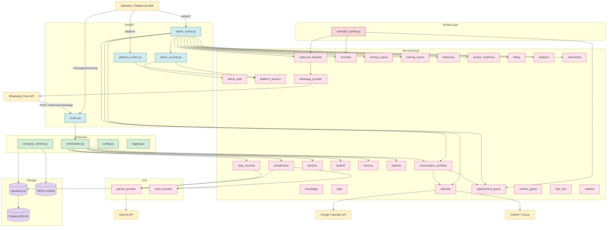

# Diagrama de Componentes

## Visão de alto nível

## Acoplamentos importantes

| Origem | Destino | Tipo | Observação |
|--------|---------|------|------------|
| `orchestrator.py` | `conversation_workflow_service.py` | função pura | Tenta primeiro tratar agenda/cancelamento/operador. |
| `reply_services.py` | `openai_provider.py` | classe | Tem fallback determinístico se faltar `OPENAI_API_KEY`. |
| `admin_routes.py` | `repository.py` | direto | Centraliza acesso a 20+ recursos administrativos. |
| `platform_routes.py` | `platform_session_service.py` | função | Emite/lê cookie HTTP-only assinado. |
| `admin_security.py` | `admin_auth_service.py` + `platform_session_service.py` | função | Aceita token via header **ou** cookie de sessão. |
| `reminder_worker.py` | `reminder_service.py` + `appointment_queue_service.py` | função | Loop com `REMINDER_WORKER_POLL_SECONDS`. |
| `outbound_dispatch_service.py` | `whatsapp_provider.py` | classe | Por canal `whatsapp`, fallback genérico. |

## Pontos de extensão

- **Novo provider LLM**: implementar interface compatível em `app/llm/providers/` e injetar via `CLASSIFICATION_PROVIDER` ou refatorar `reply_services.py`.
- **Novo provider de canal**: criar service equivalente a `whatsapp_provider.py` e plugar em `outbound_dispatch_service.py` (Instagram é o próximo declarado).
- **Novo provider de calendário**: branch em `calendar_service.py` (atualmente `mock`, `google_calendar`, `caldav`).
- **Novo papel admin**: estender `ADMIN_ROLE_HIERARCHY` em `admin_auth_service.py` e ajustar `build_require_admin_role`.

## Próximas leituras

- [[10-Architecture/01-Arquitetura em Camadas]]
- [[20-Modules/05-Services]]
- [[20-Modules/06-LLM Providers]]
