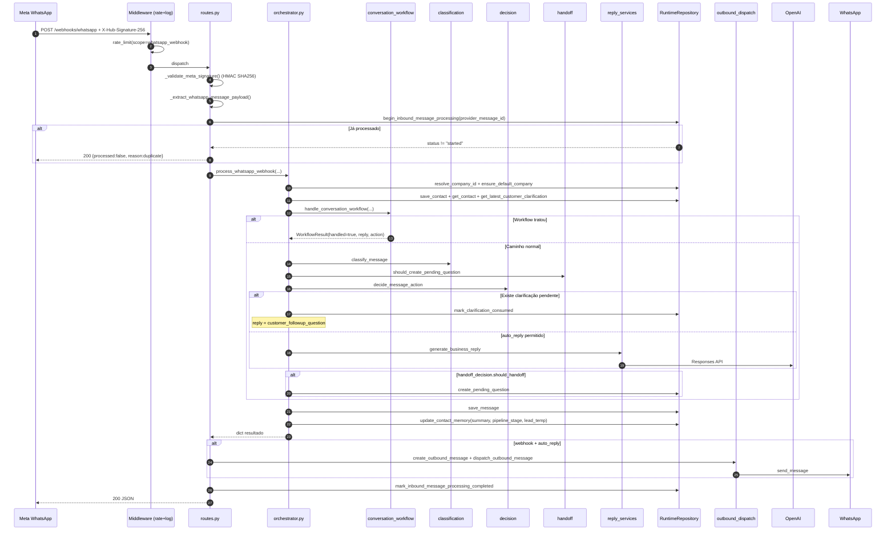

# Fluxo: Mensagem recebida do cliente

Cobre tanto `POST /messages/incoming` quanto `POST /webhooks/whatsapp`. Os dois pousam no mesmo `_process_contact_message()` (`app/core/orchestrator.py:19-266`).

## Sequência detalhada

## Pontos críticos

### Idempotência (webhook)

`app/api/routes.py:200-235`: `_begin_whatsapp_idempotent_processing()`. Se o mesmo `provider_message_id` chega duas vezes, retorna `{processed:false, reason:"duplicate_provider_message_id"}` sem reprocessar. Tabela: `inbound_message_receipts`. Detalhe em [[40-Data/02-Schema do Banco]].

### Validação HMAC do Meta

`app/api/routes.py:139-156`: `_validate_meta_signature()`. Compara `X-Hub-Signature-256` (sha256=HEX) com HMAC do `WHATSAPP_APP_SECRET` sobre o **raw body**. Usa `hmac.compare_digest` (timing-safe). Se `WHATSAPP_APP_SECRET` ausente: 503. Se header falta/diferente: 403.

### Resolução de tenant

`app/core/orchestrator.py:39-50`: ordem de prioridade:
1. `company_id` da query/header.
2. `company_slug` da query/header (resolvido via `repository.resolve_company_id`).
3. `repository.ensure_default_company()` → primeira empresa ativa ou cria/marca como default.

### Workflow conversacional primeiro

Antes de classificar, o sistema chama `handle_conversation_workflow()`. Se o contato tem fluxo aberto (agenda em andamento, cancelamento, etc.) ou a mensagem inicia um, o workflow assume.

Ver [[10-Architecture/06-Fluxo Agenda]].

### Clarificação pendente

Se o operador respondeu uma `pending_question` com `resolution_type=needs_customer_clarification`, a próxima mensagem do cliente reaproveita o `customer_followup_question` aprovado (não chama OpenAI).

### Memória + pipeline

Após responder, `memory_service.update_conversation_summary()` resume e `pipeline_service.infer_pipeline_state()` reposiciona o contato no funil. Persistência via `repository.update_contact_memory()`.

### Auto-reply outbound (apenas webhook)

Em `routes.py:159-198` (`_dispatch_whatsapp_auto_reply`): se `auto_reply=true` e `reply` não vazia, cria `outbound_message` e tenta `dispatch_outbound_message(channel="whatsapp")`. Se falhar, `outbound_message` fica com erro registrado mas o webhook continua respondendo `200`.

## Logs emitidos

Cada etapa emite log JSON estruturado via `app.core.logging.log_event`:

| Evento | Quando |
|--------|--------|
| `http.request.started` / `completed` | Middleware de observabilidade. |
| `api.whatsapp.webhook.received` / `verified` / `ignored` / `completed` / `duplicate_ignored` | Pipeline do webhook. |
| `conversation.processing.started` / `completed` | Início e fim do orchestrator. |
| `conversation.classification.completed` | Após classify. |
| `conversation.decision.completed` | Após decide. |
| `conversation.workflow.handled` | Quando workflow assume. |
| `conversation.handoff.created` | Quando cria pending_question. |
| `conversation.reply.generated` | Após gerar resposta. |

`contact_id` sempre passa por `mask_identifier()` antes de logar.

## Edge cases tratados

| Cenário | Comportamento |
|---------|---------------|
| `message` em branco após `strip()` | 400 |
| Payload Meta sem mensagem de texto (status, reaction, etc.) | 200 com `processed:false, reason:unsupported_or_non_message_event` |
| Assinatura HMAC inválida | 403 |
| `WHATSAPP_APP_SECRET` ausente em payload bruto | 503 |
| Mesmo `provider_message_id` duas vezes | 200 com `duplicate_status` |
| OpenAI offline / sem chave | Fallback determinístico em `_fallback_business_reply` |
| Empresa não cadastrada | `ensure_default_company` cria/promove a primeira |
| Auto-reply criado mas dispatch falhou | `outbound_message` persistido com `delivery_status=failed`, request retorna 200 com `auto_reply_dispatch.error` preenchido |

## Próximas leituras

- [[10-Architecture/04-Fluxo Handoff]]
- [[10-Architecture/05-Fluxo Outbound]]
- [[20-Modules/01-Core]]
