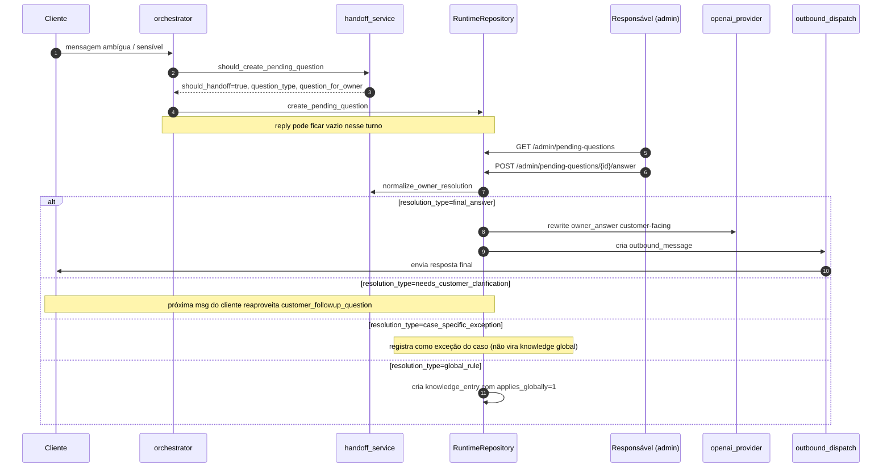

# Fluxo: Handoff humano (pending question)

Quando a IA não pode/deve decidir sozinha, o sistema cria uma `pending_question` para o responsável humano resolver.

## Quando ocorre handoff

Decisão em `app/services/handoff_service.py:should_create_pending_question()`:

| Gatilho | `question_type` |
|---------|-----------------|
| `classification == "indefinido"` ou `confidence < 0.60` | `classification_uncertain` |
| Termos: `desconto`, `abaixar`, `melhor valor`, `negociar valor` | `discount_request` |
| Termos: `tem disponível`, `estoque`, `pronta entrega` | `inventory_or_availability` |
| Outros gatilhos definidos no service (ver código atual) | conforme regra |

> Heurística simples por enquanto. Evolução natural: classificador dedicado de sensibilidade.

## Sequência



## Endpoints envolvidos

- `GET /admin/pending-questions?company_id=...` — lista abertas/históricas. Detalhe em [[30-API/02-Endpoints Admin]].
- `GET /admin/pending-questions/{id}` — detalhe.
- `POST /admin/pending-questions/{id}/answer` — payload:

```json
{
  "owner_answer": "Pode informar que ha analise caso a caso.",
  "resolution_type": "final_answer",
  "customer_followup_question": null,
  "applies_globally": true,
  "knowledge_action": "store_as_knowledge"
}
```

Resolução normalizada em `handoff_service.normalize_owner_resolution()`.

## `resolution_type` válidos

| Valor | Efeito |
|-------|--------|
| `final_answer` | Vira mensagem ao cliente (com reescrita customer-facing). |
| `needs_customer_clarification` | Não responde direto; espera próxima mensagem do cliente para usar `customer_followup_question`. |
| `case_specific_exception` | Aplica só àquele contato/caso; não vira regra. |
| `global_rule` | Vira regra geral (com `applies_globally=true`). |

## `knowledge_action` válidos

| Valor | Efeito |
|-------|--------|
| `none` | Nada. |
| `store_as_knowledge` | Cria `knowledge_entry` ativa. Detalhe em [[40-Data/02-Schema do Banco]]. |
| `promote_to_company_context` | Reservado — promoção automática para `company_context` ainda não totalmente implementada (ver [[80-Improvements/01-Limites Conhecidos]]). |

## Reescrita customer-facing

`app/services/handoff_service.py:_fallback_customer_facing_text()` faz cleanup determinístico (remove "fala pra ele que", capitaliza). Quando OpenAI configurado, `OpenAIProvider` reescreve para tom natural.

## Auditoria

Toda ação em `pending_questions` é registrada em `audit_events` com `actor_id` (header `X-Admin-Actor`), `request_id` e metadados. Detalhe em [[50-Security/07-Auditoria]].

## Próximas leituras

- [[10-Architecture/05-Fluxo Outbound]]
- [[20-Modules/05-Services]] (linha "handoff_service")
- [[40-Data/02-Schema do Banco]] (tabela `pending_questions`)
