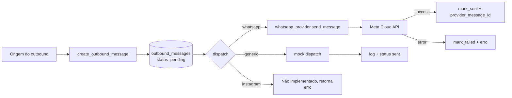

# Fluxo: Outbound persistido + dispatch

## Resumo

Toda mensagem que vai do sistema **para o cliente** passa por `outbound_messages` antes de sair. O envio efetivo é desacoplado por **provider** (`mock`, `whatsapp`, `instagram`, `generic`). Implementado em `app/services/outbound_dispatch_service.py`.

## Quando um outbound é criado

| Gatilho | Source | Onde no código |
|---------|--------|----------------|
| Auto-reply via webhook | `whatsapp_auto_reply` | `app/api/routes.py:_dispatch_whatsapp_auto_reply` |
| Resposta humana a `pending_question` virando mensagem ao cliente | `pending_question_resolution` | `admin_routes.py` POST answer |
| Lembrete materializado (cliente ou interno) | `reminder_dispatch` | `app/services/reminder_service.py` |
| Oferta de remanejamento | `appointment_queue_offer` | `app/services/appointment_queue_service.py` |

## Diagrama

## Status possíveis

| status | Significado |
|--------|-------------|
| `pending` | Criada mas não despachada. |
| `sent` | Despacho retornado com sucesso, `provider_message_id` salvo. |
| `failed` | Provider erro (`OutboundDispatchError`). |
| `canceled` | Cancelada manualmente ou pelo cleanup. |

## Endpoints administrativos

Todos sob `/admin/outbound-messages*`, RBAC `operator+`:

- `GET /admin/outbound-messages` — listagem por empresa.
- `GET /admin/outbound-messages/{id}` — detalhe.
- `POST /admin/outbound-messages/{id}/mark-sent` — marca manualmente como enviada.
- `POST /admin/outbound-messages/{id}/dispatch?channel=whatsapp` — dispara um único.
- `POST /admin/outbound-messages/dispatch-pending?channel=whatsapp` — dispara todos pendentes.

`channel` aceitos: `whatsapp`, `instagram`, `generic`.

## Provider real WhatsApp

`app/services/whatsapp_provider.py`:

- Usa `requests` para chamar `{WHATSAPP_API_BASE_URL}/{WHATSAPP_PHONE_NUMBER_ID}/messages`.
- `Authorization: Bearer {WHATSAPP_API_TOKEN}`.
- Body: `{"messaging_product":"whatsapp", "to": contact_id, "type":"text", "text":{"body":...}}`.
- Timeout 20s.
- Falha → `WhatsAppProviderError` com payload do erro.

## Idempotência

O outbound em si **não é idempotente** atualmente — se você chamar `dispatch` duas vezes em uma mensagem `pending`, ela tenta enviar duas vezes. Mitigação atual: status muda para `sent` na primeira; chamadas seguintes ignoram. Mas o estado intermediário (envio em andamento) não tem lock — em alta concorrência, há janela de risco.

Tracking: [[80-Improvements/02-Issues Identificados]].

## Próximas leituras

- [[20-Modules/05-Services]]
- [[40-Data/02-Schema do Banco]] (tabela `outbound_messages`)
- [[60-Operations/07-Provider WhatsApp Real]]
