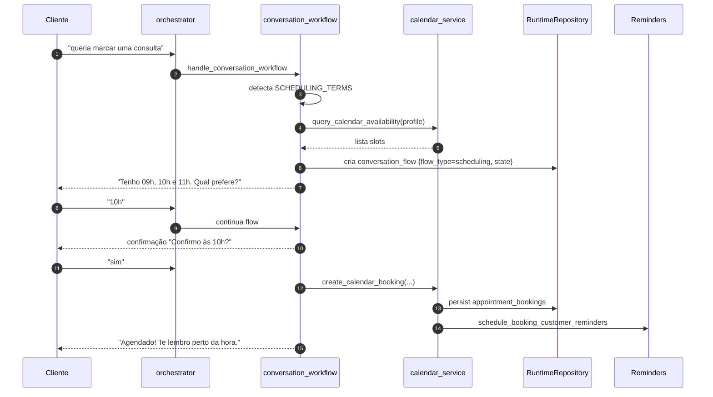

# Fluxo: Agenda completa

Cobre quatro frentes:

1. **Cliente agendando por conversa natural.**
2. **Cliente cancelando ou reagendando seu próprio horário.**
3. **Operador interno** ("marca a Maria amanhã às 10h") via WhatsApp.
4. **Fila de remanejamento** quando uma vaga é liberada.

## Componentes

| Arquivo | Papel |
|---------|-------|
| `app/services/conversation_workflow_service.py` | Decide qual fluxo conversacional aplicar e mantém estado em `conversation_flows`. |
| `app/services/calendar_service.py` | Disponibilidade, criação/cancelamento/reagendamento de booking, sync com provider externo. |
| `app/services/appointment_queue_service.py` | Fila de prioridade, ofertas, follow-ups. |
| `app/services/reminder_service.py` | Lembretes de booking (cliente) e internos (equipe). |
| `app/tools/reminder_worker.py` | Worker que materializa e dispara lembretes vencidos. |

## Pré-condições

Por empresa, no `company_context`:

```json
{
  "enabled_modules": { "scheduling": true, "reminders": true },
  "scheduling_policy": {
    "default_profile_key": "novos",
    "profiles": [
      {
        "key": "novos",
        "label": "Clientes novos",
        "allowed_weekdays": ["monday","wednesday"],
        "day_windows": {"monday":"09:00-12:00"},
        "service_names": ["Consultoria inicial"],
        "customer_profiles": ["new_customer"],
        "minimum_notice_minutes": 180,
        "default_duration_minutes": 60,
        "slot_increment_minutes": 30
      }
    ]
  },
  "internal_operation": {
    "operator_contact_ids": ["5511999990000"]
  }
}
```

Detalhe do contrato em [[40-Data/05-Company Context]].

## Sequência: cliente agendando



## Sequência: cancelamento ou reagendamento natural

`conversation_workflow_service._continue_booking_change_flow()`:

1. Detecta termos como `cancelar meu horário`, `remarcar`, `desmarcar`.
2. Lista bookings futuros do contato.
3. Se mais de um, pede desambiguação (1, 2, 3).
4. Confirma ação.
5. Aplica: `cancel_calendar_booking()` ou `reschedule_calendar_booking()`.
6. Se for cancelamento e `appointment_queue_auto_dispatch=true`, chama `release_booking_slot()` para criar oferta para próximos da fila.

## Sequência: operador interno

Trigger: contato que está em `internal_operation.operator_contact_ids`.

`conversation_workflow_service._continue_operator_booking_flow()`:

1. Detecta termos como `marca o cliente`, `agenda para`, `encaixa`.
2. Usa OpenAI (interpretation) para extrair `customer_query`, `date`, `time`.
3. Busca contatos por nome ou telefone (`_find_contact_matches`).
4. Se vários matches, pede desambiguação.
5. Consulta disponibilidade respeitando perfil.
6. Pede confirmação final ao operador.
7. Cria booking.

## Fila de remanejamento

`app/services/appointment_queue_service.py`:

- Tabelas `appointment_queue_entries` e `appointment_queue_offers`.
- `release_booking_slot()`: chamada após cancelamento.
- Pega próximos da fila por ordem de prioridade.
- Cria `appointment_queue_offers` com `response_window_minutes` (default 30, env `APPOINTMENT_QUEUE_RESPONSE_WINDOW_MINUTES`).
- Materializa outbound de oferta para cada candidato.
- Cliente responde "aceito"/"não posso"/"em 30min eu confirmo" — interpretação natural.
- Se aceitar, vira booking real e ofertas pendentes para outros são canceladas.
- Follow-up automático em `APPOINTMENT_QUEUE_WAIT_FOLLOWUP_MINUTES`.

## Endpoints relevantes

Detalhe em [[30-API/02-Endpoints Admin]]. Resumo:

- `GET /admin/calendar/profile?company_id=...`
- `GET /admin/calendar/integrations`
- `POST /admin/calendar/integrations` (superadmin)
- `POST /admin/calendar/availability/query` (operator)
- `POST /admin/calendar/bookings` (operator)
- `POST /admin/calendar/bookings/{id}/reschedule` (operator)
- `POST /admin/calendar/bookings/{id}/cancel` (operator)
- `GET /admin/calendar/queue` / `POST /admin/calendar/queue` / `GET /admin/calendar/queue-offers` / `POST /admin/calendar/queue-offers/{id}/respond`
- `GET /admin/calendar/timeline?start_date=&days=`
- `GET /admin/reminders` / `POST /admin/reminders` / `POST /admin/reminders/dispatch-due`

## Providers de calendário

| Provider | Modo | Status |
|----------|------|--------|
| `mock` | Local, sem credenciais | Default e padrão para validação UX. |
| `google_calendar` | OAuth refresh token | Preparado, exige `GOOGLE_CALENDAR_CLIENT_ID/_SECRET/_REFRESH_TOKEN/_ID`. |
| `caldav` | Basic auth ou app password | Preparado, exige `CALDAV_URL/_USERNAME/_PASSWORD/_CALENDAR_NAME`. |

Implementação de leitura/escrita em `calendar_service.py`. Cancelamento e reagendamento sincronizam `external_event_id` quando integração ativa.

## Próximas leituras

- [[20-Modules/05-Services]]
- [[40-Data/02-Schema do Banco]] (tabelas `appointment_*`, `conversation_flows`, `customer_reminders`)
- [[60-Operations/05-Worker de Lembretes]]
