# Fluxo: Pipeline de Fine-Tuning

## Etapas

```mermaid
flowchart LR
  Hist[Histórico CRM/CSV/JSON] --> Imp[training_import_service]
  Imp --> Examples[(message_examples<br/>active=1)]
  Manual[Curadoria manual /admin/message-examples] --> Examples
  Examples --> Filter[is_example_eligible_for_training]
  Filter --> Dedup[deduplicate_examples]
  Dedup --> Limit[limit_examples_per_scenario]
  Limit --> Split[split treino/validação]
  Split --> Export[JSONL chat-completions]
  Export --> Bundle[GET /admin/finetuning-dataset/bundle]
  Bundle --> Job[POST /admin/finetuning/jobs]
  Job --> OpenAI[OpenAI fine-tuning API]
  OpenAI --> Persist[(finetuning_jobs)]
  Persist --> Plug[OPENAI_FINETUNED_MODEL + USE_FINETUNED_MODEL_FOR_REPLIES]
```



## Importação histórica

`app/services/training_import_service.py` (`POST /admin/training-import`):

- Aceita CSV ou JSON cru.
- Modo `dry_run=true` retorna preview sem persistir.
- Atualiza `customer_profile` em `contacts` quando `update_contacts=true`.
- Cria `message_examples` quando `create_message_examples=true`.
- `auto_promote_eligible_examples=true` marca exemplos qualificados como ativos.

Exemplo de CSV mínimo:

```
contact_id,contact_name,customer_profile,profile_name,scenario_type,customer_message,approved_reply,quality_score
5511999999999,Maria Silva,returning_customer,retorno,reschedule,Quero remarcar,Claro,9
```

## Curadoria manual

`POST /admin/message-examples` (operator+):

```json
{
  "profile_name": "lead_qualificado",
  "scenario_type": "lead_novo",
  "customer_message": "...",
  "approved_reply": "...",
  "quality_score": 9,
  "active": true
}
```

## Filtro de elegibilidade

`app/services/training_export_service.py:is_example_eligible_for_training()`:

| Critério | Constante (em `training_config.py`) |
|----------|-------------------------------------|
| `quality_score ≥ 8.0` | `MIN_QUALITY_SCORE` |
| `scenario_type` não em `{"financial","support"}` | `EXCLUDED_SCENARIO_TYPES` |
| `customer_message` e `approved_reply` não vazios | — |
| Não contém marker sensível: `cpf, cnpj, cartão, senha, token, nota fiscal, fatura, boleto` | `SENSITIVE_MARKERS` |
| `@` no texto vira `[EMAIL_REDACTED]` | `REDACTION_PATTERNS` |

> ⚠️ **Sanitização atual é básica.** Para dados reais, ver [[50-Security/06-PII e Dataset]].

## Dedup

`deduplicate_examples()` faz hash composto (`profile_name`, `scenario_type`, `customer_message`, `approved_reply`) com `lower()` se `DEDUP_NORMALIZE_CASE=true`.

## Limite por cenário

`limit_examples_per_scenario()` aplica `MAX_EXAMPLES_PER_SCENARIO=50` para evitar viés.

## Split treino/validação

`VALIDATION_RATIO=0.2` → 80% train / 20% validation (com `random.shuffle` e `random.seed` reprodutível).

## Export

| Endpoint | Formato | Uso |
|----------|---------|-----|
| `GET /admin/training-dataset/json` | JSON pretty | Debug local. |
| `GET /admin/training-dataset/jsonl` | JSONL | Compatível com OpenAI. |
| `GET /admin/training-dataset/split` | JSON com `train` e `validation` | Inspecionar split. |
| `GET /admin/training-dataset/review` | JSON (relatório) | Quantos elegíveis, quantos descartados, motivos. |
| `GET /admin/finetuning-dataset/train-jsonl` | JSONL formatado p/ OpenAI | Upload direto. |
| `GET /admin/finetuning-dataset/validation-jsonl` | JSONL | Idem. |
| `GET /admin/finetuning-dataset/bundle` | ZIP/JSON consolidado | Pré-job. |

## Criar job

`POST /admin/finetuning/jobs` (operator+):

```json
{
  "base_model": "gpt-4o-mini-2024-07-18",
  "suffix": "project-wapp-style"
}
```

Defaults caem em `OPENAI_FINETUNING_BASE_MODEL` e `OPENAI_FINETUNING_SUFFIX`. Job é persistido em `finetuning_jobs` e segue o ciclo da OpenAI.

## Plugar o modelo treinado

```env
OPENAI_FINETUNED_MODEL=ft:gpt-4o-mini-2024-07-18:org::abc123
USE_FINETUNED_MODEL_FOR_REPLIES=true
```

`reply_services.py` automaticamente passa a usar `openai_finetuned` como `source` quando essas duas flags estão configuradas.

## Limites atuais

- Pipeline pronto, **mas nenhum job concluído com sucesso documentado** ainda.
- `ENABLE_FINETUNING_PIPELINE=false` por padrão. Habilitar antes de criar job.
- Mínimo de 10 exemplos elegíveis (`MINIMUM_REQUIRED_FINETUNING_EXAMPLES=10`).
- Sanitização de PII rudimentar — exige etapa adicional para usar conversas reais.

## Próximas leituras

- [[20-Modules/05-Services]] (linhas training_*)
- [[50-Security/06-PII e Dataset]]
- [[80-Improvements/03-Melhorias de Segurança]]
