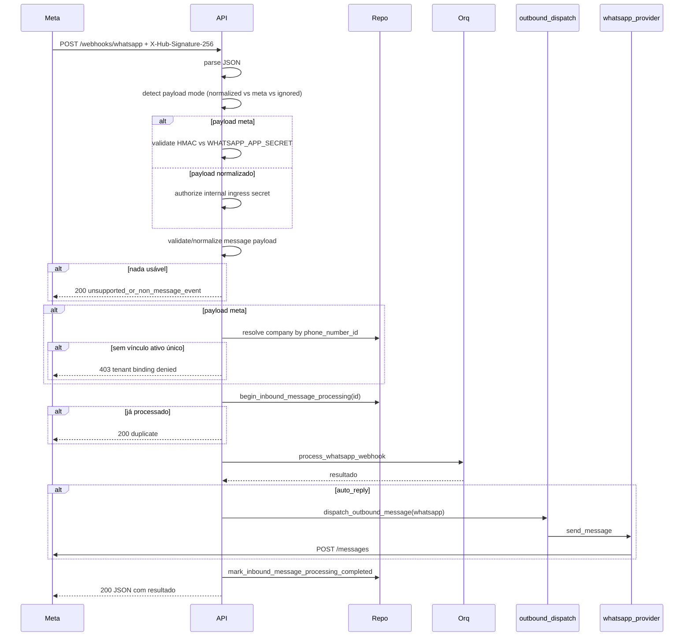

# Webhook WhatsApp Cloud API

Implementação em `app/api/routes.py`, com autenticação de ingress em `app/services/ingress_auth_service.py` e `app/api/ingress_security.py`.

## Handshake (Meta)

`GET /webhooks/whatsapp`

Query:
- `hub.mode=subscribe`
- `hub.verify_token`
- `hub.challenge`

Comportamento:
- Se `hub.mode != subscribe` ou `hub.challenge` ausente → 400.
- Se `WHATSAPP_WEBHOOK_VERIFY_TOKEN` não configurado → 503.
- Se `hub.verify_token` não confere → 403 (comparação em tempo constante via `secrets_match`).
- Se OK → retorna `hub.challenge` em `text/plain`.

Logs: `api.whatsapp.webhook.verified`.

## Recepção

`POST /webhooks/whatsapp`

### Aceita dois formatos

O modo é detectado **antes** de qualquer autenticação, parsing pesado ou efeito
colateral; em seguida o modo correspondente é autenticado; só então o payload é
normalizado e processado.

#### 1. Normalizado interno (desabilitado por padrão)

```json
{
  "event": "message.received",
  "from_number": "5511999999999",
  "from_name": "Cliente",
  "text": "oi",
  "provider_message_id": "wamid.HBgL..."
}
```

Este modo **não** carrega assinatura Meta, portanto é protegido por segredo próprio:

| Situação | Resposta |
|----------|----------|
| `ENABLE_NORMALIZED_WHATSAPP_INGRESS=false` (padrão) | `403 Normalized webhook ingress is disabled.` |
| Habilitado sem `INTERNAL_INGRESS_SECRET` real (ausente ou placeholder `change-me-*`) | `503 Internal ingress authentication is not configured.` |
| Habilitado, credencial ausente | `401 Missing internal ingress credentials.` |
| Habilitado, credencial inválida | `401 Invalid internal ingress credentials.` |
| Habilitado, credencial válida | `200` com processamento normal |

A credencial é enviada em `X-Internal-Ingress-Secret: <segredo>` ou
`Authorization: Bearer <segredo>`, e comparada em tempo constante
(`hmac.compare_digest` sobre bytes UTF-8). O segredo nunca aparece em log:
apenas o evento `api.ingress.auth.denied` com `ingress_surface` e `denial_reason`.

Validações de payload (`NormalizedWhatsAppPayload`): `text` e `from_number` não
podem ser brancos, e os limites de tamanho abaixo são aplicados (violação → 422).

| Campo | Limite |
|-------|--------|
| `event` | 100 |
| `from_number` | 64 |
| `from_name` | 200 |
| `text` | 4096 |
| `provider_message_id` | 200 |

#### 2. Bruto Meta (Cloud API)

```json
{
  "object": "whatsapp_business_account",
  "entry": [{
    "changes": [{
      "value": {
        "messages": [{
          "id":"wamid.ABC",
          "from":"5511999999999",
          "type":"text",
          "text": { "body": "oi" }
        }],
        "contacts": [{
          "wa_id":"5511999999999",
          "profile": { "name": "Cliente" }
        }]
      }
    }]
  }]
}
```

Validação extra: header `X-Hub-Signature-256: sha256=<hex>` precisa conferir com HMAC-SHA256 do raw body usando `WHATSAPP_APP_SECRET`. Se faltar secret → 503; se header ausente ou inválido → 403. **Todo** payload com `object=whatsapp_business_account` exige assinatura válida, inclusive eventos de status que serão ignorados. Os mesmos limites de tamanho do modo normalizado são aplicados à mensagem extraída.

#### Resolução de tenant (obrigatória)

Uma assinatura válida prova que o payload veio do Meta — **não** autoriza um
tenant. A empresa é resolvida exclusivamente a partir de
`value.metadata.phone_number_id` do payload assinado, consultando
`whatsapp_channel_bindings` (ver [[40-Data/02-Schema do Banco]]).

| Situação | Resposta |
|----------|----------|
| `phone_number_id` ausente no payload | `403` |
| `phone_number_id` sem vínculo | `403` |
| Vínculo inativo | `403` |
| Vínculo ambíguo (mais de um ativo) | `403` |
| Empresa do vínculo inativa | `403` |
| Vínculo ativo e único | `200`, processado sob aquela empresa |

Regras adicionais:

- **`company_id`, `company_slug`, `X-Company-Id` e `X-Company-Slug` são ignorados
  no modo Meta.** Não é possível redirecionar um evento assinado para outro tenant.
- **A empresa padrão nunca é usada como fallback** para eventos Meta.
- `display_phone_number` é dado de apresentação e **não** serve como identidade;
  o identificador é `phone_number_id`.
- A empresa resolvida acompanha todo o fluxo: recibo de idempotência,
  processamento, persistência de contato, publicação em tempo real, contexto de
  log/auditoria e dispatch da resposta.
- Negações são registradas como `api.whatsapp.webhook.tenant_binding_denied` com
  o motivo, sem expor segredos.

#### Conflitos de vínculo

A unicidade de um número **ativo** é garantida pelo índice parcial
`idx_whatsapp_bindings_active_phone`, não por uma verificação prévia em
aplicação. O `SELECT` de preflight existe apenas para dar uma rejeição rápida;
quem decide é o banco. Violações desse índice específico (identificado por
`constraint_name` no PostgreSQL e por `table.column` no SQLite) são traduzidas
em conflito de domínio. Qualquer outro erro de integridade continua propagando.

| Situação | Resultado |
|----------|-----------|
| Número já ativo em outra empresa, tentativa de `PUT` ativo | `409` |
| Vínculo histórico reativado depois de o número migrar para outra empresa | `409` |
| Duas requisições concorrentes ativando/criando o mesmo número | Exatamente uma vence; as demais recebem `409` |
| Vínculo inexistente | `404` |
| Ativação/desativação bem-sucedida | `200` com o contrato existente |
| Desativação | Nunca conflita |

Garantias:

- Nenhuma exceção de integridade do SQLite ou do PostgreSQL escapa como `500`.
- Uma operação rejeitada não deixa estado parcial: o conflito é capturado fora do
  bloco transacional, então o rollback já aconteceu.
- Um número ativo nunca é reatribuído silenciosamente entre tenants.
- Conflitos são auditados com `status=conflict`, nunca como sucesso.

#### Política do modo normalizado

O modo normalizado **pode** selecionar o tenant explicitamente via
`company_id`/`company_slug` (a empresa precisa existir; `404` caso contrário).
Isso é aceitável porque a rota é protegida pelo `INTERNAL_INGRESS_SECRET` e o
portador do segredo é um componente interno confiável — diferente do webhook
Meta, cuja assinatura autentica a *origem* mas não o *tenant*.

#### Saída (outbound)

`WhatsAppProvider(company_id=...)` resolve o `phone_number_id` de envio pelo
vínculo ativo da empresa da mensagem. Uma resposta do Tenant B nunca sai pelo
número do Tenant A. Sem vínculo ativo único, o envio falha com erro acionável
(`... has no single active WhatsApp channel binding`) em vez de usar outro número.
O token de acesso continua em variável de ambiente.

### Eventos não suportados

Status updates, reactions, mídia que não seja `type=text` etc. retornam:

```json
{
  "processed": false,
  "reason": "unsupported_or_non_message_event",
  "payload_mode": "meta"
}
```

Status 200 (Meta exige 200 rápido para não retentar).

### Idempotência

`provider_message_id` (campo `id` do Meta) é usado para barrar reprocessamento. Tabela `inbound_message_receipts`. Se chega outro POST com mesmo id, retorna `200` com `processed:false, reason:"duplicate_provider_message_id"`.

### Auto-reply outbound

Se `result.auto_reply=true` e `result.reply` não vazia:
1. Cria `outbound_message` com `source=whatsapp_auto_reply`, `status=pending`.
2. Tenta `dispatch_outbound_message(channel="whatsapp")`.
3. Se sucesso → outbound vira `sent` com `provider_message_id`.
4. Se falha → outbound vira `failed`, request ainda retorna 200 com `auto_reply_dispatch.error`.

## Diagrama



## Configuração mínima

```env
WHATSAPP_API_BASE_URL=https://graph.facebook.com/v22.0
WHATSAPP_API_TOKEN=<EAA...>
WHATSAPP_PHONE_NUMBER_ID=<ID>
WHATSAPP_WEBHOOK_VERIFY_TOKEN=<token forte>
WHATSAPP_APP_SECRET=<app secret real>

# Ingress interno (opcional; desabilitado por padrão)
ENABLE_NORMALIZED_WHATSAPP_INGRESS=false
INTERNAL_INGRESS_SECRET=<segredo forte>
```

Além da configuração, o `WHATSAPP_PHONE_NUMBER_ID` precisa estar vinculado a
exatamente uma empresa ativa:

```http
PUT /admin/whatsapp/bindings        # superadmin
{ "company_id": 1, "phone_number_id": "<id do Meta>", "active": true }
```

A readiness reporta `whatsapp_channel_binding` como blocker enquanto isso não
estiver correto.

Detalhe operacional em [[60-Operations/07-Provider WhatsApp Real]].

## Próximas leituras

- [[10-Architecture/03-Fluxo Mensagem Recebida]]
- [[50-Security/03-Webhook HMAC]]
- [[40-Data/02-Schema do Banco]] (tabela `inbound_message_receipts`)
- [[30-API/01-Endpoints Públicos]] (autenticação de `/messages/incoming`)
