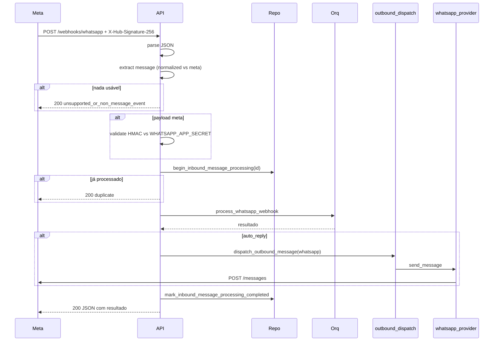

# Webhook WhatsApp Cloud API

Implementação em `app/api/routes.py:115-417`.

## Handshake (Meta)

`GET /webhooks/whatsapp`

Query:
- `hub.mode=subscribe`
- `hub.verify_token`
- `hub.challenge`

Comportamento:
- Se `hub.mode != subscribe` ou `hub.challenge` ausente → 400.
- Se `WHATSAPP_WEBHOOK_VERIFY_TOKEN` não configurado → 503.
- Se `hub.verify_token` não confere → 403.
- Se OK → retorna `hub.challenge` em `text/plain`.

Logs: `api.whatsapp.webhook.verified`.

## Recepção

`POST /webhooks/whatsapp`

### Aceita dois formatos

#### 1. Normalizado interno

```json
{
  "event": "message.received",
  "from_number": "5511999999999",
  "from_name": "Cliente",
  "text": "oi",
  "provider_message_id": "wamid.HBgL..."
}
```

Validação: `text` e `from_number` não podem ser brancos.

#### 2. Bruto Meta (Cloud API)

```json
{
  "object": "whatsapp_business_account",
  "entry": [{
    "changes": [{
      "value": {
        "messages": [{
          "id":"wamid.ABC",
          "from":"5511999999999",
          "type":"text",
          "text": { "body": "oi" }
        }],
        "contacts": [{
          "wa_id":"5511999999999",
          "profile": { "name": "Cliente" }
        }]
      }
    }]
  }]
}
```

Validação extra: header `X-Hub-Signature-256: sha256=<hex>` precisa conferir com HMAC do raw body usando `WHATSAPP_APP_SECRET`. Se faltar secret → 503; se header inválido → 403.

### Eventos não suportados

Status updates, reactions, mídia que não seja `type=text` etc. retornam:

```json
{
  "processed": false,
  "reason": "unsupported_or_non_message_event",
  "payload_mode": "meta"
}
```

Status 200 (Meta exige 200 rápido para não retentar).

### Idempotência

`provider_message_id` (campo `id` do Meta) é usado para barrar reprocessamento. Tabela `inbound_message_receipts`. Se chega outro POST com mesmo id, retorna `200` com `processed:false, reason:"duplicate_provider_message_id"`.

### Auto-reply outbound

Se `result.auto_reply=true` e `result.reply` não vazia:
1. Cria `outbound_message` com `source=whatsapp_auto_reply`, `status=pending`.
2. Tenta `dispatch_outbound_message(channel="whatsapp")`.
3. Se sucesso → outbound vira `sent` com `provider_message_id`.
4. Se falha → outbound vira `failed`, request ainda retorna 200 com `auto_reply_dispatch.error`.

## Diagrama



## Configuração mínima

```env
WHATSAPP_API_BASE_URL=https://graph.facebook.com/v22.0
WHATSAPP_API_TOKEN=<EAA...>
WHATSAPP_PHONE_NUMBER_ID=<ID>
WHATSAPP_WEBHOOK_VERIFY_TOKEN=<token forte>
WHATSAPP_APP_SECRET=<app secret real>
```

Detalhe operacional em [[60-Operations/07-Provider WhatsApp Real]].

## Próximas leituras

- [[10-Architecture/03-Fluxo Mensagem Recebida]]
- [[50-Security/03-Webhook HMAC]]
- [[40-Data/02-Schema do Banco]] (tabela `inbound_message_receipts`)
