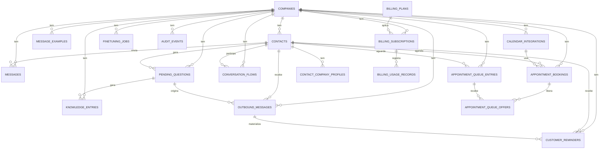

# Modelo de Dados (visão lógica)

Tudo persistido via `app/storage/repository.py` em SQLite ou Postgres. Schema descrito em [[40-Data/02-Schema do Banco]].

## Diagrama ER simplificado

## Conceitos centrais

### Tenant

`companies` é a raiz de todo escopo multi-tenant. Identificada por `slug` (string normalizada) e `id` (int).

### Contato

`contacts` tem chave primária `contact_id` (string global, geralmente o número WhatsApp). **Atenção**: o contato é compartilhado entre empresas; perfis tenant-specific ficam em `contact_company_profiles` (chave composta `(contact_id, company_id)`). Migração 022 introduziu essa separação.

### Mensagem

`messages` armazena a mensagem do cliente + reply gerado, com classificação, ação, prioridade, source, confidence. Não há retenção automática nessa tabela ainda.

### Pending question

`pending_questions` é a fila de handoff. Status: `pending|answered|archived`. Tem `clarification_consumed` para o caso `needs_customer_clarification`.

### Knowledge entry

`knowledge_entries` armazena conhecimento incremental (resposta humana virou regra). `applies_globally` define se vale para todos os contatos ou só para o origem.

### Message example

`message_examples` é o **dataset cru** de respostas aprovadas. Curadoria filtra para `finetuning_jobs`.

### Outbound

`outbound_messages` é fila persistida de envios pendentes. Provider real envia e atualiza status.

### Booking

`appointment_bookings` carrega `external_event_id` quando provider externo está plugado. `scheduling_profile_key` e `customer_profile` permitem segmentação.

### Queue

`appointment_queue_entries` (interesse na fila) → ofertas em `appointment_queue_offers` (oferta concreta). Detalhe em [[10-Architecture/06-Fluxo Agenda]].

### Reminder

`customer_reminders` cobre **dois públicos**:
- `audience=customer`: lembrete materializado para o cliente (geralmente derivado de booking).
- `audience=internal`: lembrete operacional para equipe.

### Conversation flow

`conversation_flows` armazena estado intermediário de fluxos conversacionais (escolha de horário, confirmação, etc.). `state_json` flexível.

### Inbound message receipt

`inbound_message_receipts` é a tabela de **idempotência** do webhook. Chave composta `(provider, provider_message_id, company_id)`.

### Audit event

`audit_events` registra ações administrativas com `actor_id`, `request_id`, `action`, `resource_*`, `metadata`, `http_method`, `http_path`, `status`.

### Billing

- `billing_plans` — definição dos 3 planos (Essencial, Avancado, Premium) com `limits_json` e `features_json`.
- `billing_subscriptions` — assinatura ativa por empresa.
- `billing_usage_records` — métricas de uso (`messages`, `bookings`, `outbound_campaigns`, `handoffs`, `finetuning_jobs`).

## Relação dados ↔ contexto JSON

| Onde fica | Conteúdo |
|-----------|----------|
| Banco (`company_contexts`) | Contexto ativo por empresa: `conversation_pipelines` (canvas), `scheduling_policy.profiles`, `internal_operation`, `revision`, `schema_version`. |
| Banco (demais tabelas) | Mensagens, contatos, bookings, fila, lembretes, jobs, auditoria, billing. |
| `app/data/company_context.json` | **Seed** do contexto global. |
| `app/data/company_contexts/{slug}.json` | **Seed** por empresa. |

Detalhe em [[40-Data/05-Company Context]].

## Próximas leituras

- [[40-Data/02-Schema do Banco]]
- [[40-Data/04-Multi-tenant]]
- [[40-Data/05-Company Context]]
