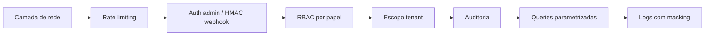

# Modelo de Ameaças

> Threat model em alto nível. Não substitui pentest, mas mapeia onde estão as superfícies sensíveis.

## Superfícies de ataque

### 1. Webhook do WhatsApp (`POST /webhooks/whatsapp`)
- **Risco**: payload forjado ou replay.
- **Mitigação**:
  - Validação HMAC SHA-256 obrigatória (`X-Hub-Signature-256`) com `WHATSAPP_APP_SECRET`.
  - `hmac.compare_digest` (timing-safe).
  - Idempotência por `provider_message_id` (`inbound_message_receipts`).
  - Rate limit por escopo `whatsapp_webhook`.
- Detalhe em [[50-Security/03-Webhook HMAC]].

### 2. API admin (`/admin/*`)
- **Risco**: acesso não autorizado a dados de operação, contatos, mensagens.
- **Mitigação**:
  - `ENABLE_ADMIN_AUTH=true` em produção.
  - Tokens por papel (viewer/operator/superadmin).
  - Sessão web HTTP-only assinada (cookie).
  - Auditoria persistida em `audit_events`.
  - Rate limit (`admin` scope, default 180 req/min).
- Detalhe em [[50-Security/02-Auth Admin]].

### 3. Plataforma `/platform`
- **Risco**: roubo de credencial via XSS.
- **Mitigação**:
  - Cookie `HttpOnly`, `SameSite=Lax`, `Secure` em produção.
  - JS nunca recebe o token bruto.
  - Não há `dangerouslySetInnerHTML` equivalente; render server-side mínimo.
- Possível gap: **CSP** (Content Security Policy) explícita ainda não definida.

### 4. Submissão de mensagem `/messages/incoming`
- **Risco**: spam de mensagens, DoS, abuso de OpenAI.
- **Mitigação**:
  - Rate limit por escopo `incoming_message`.
  - Resolução de tenant antes de processar.
  - Logs com `mask_identifier` para minimizar exposição em logs.
- **Gap**: não há autenticação obrigatória nesse endpoint; em produção, expor apenas via webhook + rede privada.

### 5. Integrações externas (OpenAI, WhatsApp, Google Calendar, CalDAV)
- **Risco**: vazamento de chave / tokens.
- **Mitigação**:
  - Chaves apenas em env (não em git).
  - Logs **nunca** registram corpo de mensagem nem chaves.
  - URL de Postgres é redactada em logs (`_redact_database_url`).

### 6. Banco de dados
- **Risco**: SQL injection, exposição de PII.
- **Mitigação**:
  - Todas as queries usam parâmetros (`?` ou `%s`), nunca string interpolation.
  - Statement timeout configurável.
  - Pool com tamanho controlado.
- **Gap**: não há RLS (Row Level Security) — multi-tenant é por disciplina de query, não enforcement do banco.

### 7. Backups e datasets de fine-tuning
- **Risco**: dados sensíveis (CPF, telefone, conteúdo) vazando para treino.
- **Mitigação**:
  - Markers sensíveis bloqueiam exemplos para treino.
  - Redação simples de `@` (email).
  - Gate `ENABLE_FINETUNING_PIPELINE=false` por padrão.
- **Gap**: sanitização rudimentar. Detalhe em [[50-Security/06-PII e Dataset]].

## Atores de ameaça considerados

| Ator | Cenário |
|------|---------|
| Atacante externo anônimo | Tenta forjar webhook, fazer DoS, descobrir endpoints. |
| Operador interno comprometido | Token vazou; usa privilégios para extrair dados. |
| Tenant adversário | Tenta acessar dados de outras empresas via parâmetros. |
| Automação de cliente final | Spam de mensagens fora de horário. |
| Provedor LLM | Vazamento de prompts; mitigado por redaction antes de mandar para treino. |

## Camadas de defesa

## Lacunas conhecidas

- Sem CSP explícita.
- Sem WAF/proxy reverso documentado.
- Sem rotação automática de tokens.
- Sem MFA para login admin.
- Sem identidade individual (todos compartilham os tokens por papel).
- Rate limit em memória (não compartilhado entre réplicas).
- Sem RLS no banco.

Tracking em [[80-Improvements/03-Melhorias de Segurança]].

## Próximas leituras

- [[50-Security/02-Auth Admin]]
- [[50-Security/03-Webhook HMAC]]
- [[50-Security/06-PII e Dataset]]
- [[80-Improvements/03-Melhorias de Segurança]]
