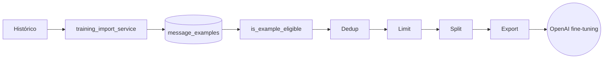

# PII e Dataset de Fine-Tuning

## Estado atual

Sanitização **rudimentar**. Suficiente para piloto controlado; **não** suficiente para usar histórico bruto de cliente real diretamente em treino.

## Mecanismos atuais

### 1. Markers sensíveis

`app/core/training_config.py`:

```python
SENSITIVE_MARKERS = [
    "cpf", "cnpj", "cartão", "cartao", "senha",
    "token", "nota fiscal", "fatura", "boleto",
]
```

`is_example_eligible_for_training()` rejeita exemplo se marker aparece em `customer_message` ou `approved_reply`.

### 2. Redação de e-mail

```python
REDACTION_PATTERNS = [("@", "[EMAIL_REDACTED]")]
```

> Substitui apenas o caractere `@` — não captura formato completo. Marca presença de e-mail mas não anonimiza nome/domínio. **Limitação relevante**.

### 3. Cenários excluídos

```python
EXCLUDED_SCENARIO_TYPES = {"financial", "support"}
```

Cenários sensíveis ficam fora do dataset.

### 4. Qualidade mínima

`MIN_QUALITY_SCORE = 8.0` reduz volume — quem é curador dá nota.

## O que NÃO está sanitizado

- Telefone, número do contato (`contact_id` é o próprio número WhatsApp).
- Endereço, cidade, datas pessoais.
- Nome próprio em texto livre.
- CEPs, RG, número de pedido.
- Fragmentos de conversa multi-turno.
- Anexos (imagens, áudio, PDF).

## Onde isso aparece no fluxo



A barreira efetiva é `Filter` — qualquer dado sensível que **não** acionar marker passa.

## Política recomendada

> Antes de subir para fine-tuning real:

1. Importar histórico para staging separado (dry-run).
2. Rodar `GET /admin/training-dataset/review` para ver elegíveis.
3. Aplicar **etapa dedicada de PII scrub** com:
   - regex para CPF (`\d{3}\.?\d{3}\.?\d{3}-?\d{2}`),
   - CNPJ, CEP, RG,
   - telefone (mais robusto que contact_id puro),
   - nome próprio (NER, requer modelo dedicado),
   - endereço.
4. Anonimizar `contact_id` para hash de ID interno.
5. Revisar manualmente uma amostra antes de exportar para OpenAI.
6. Apenas então rodar `POST /admin/finetuning/jobs`.

## Backup como vetor

`app/tools/export_runtime_backup.py` exporta **tudo cru** para JSON. Esses backups contêm PII completo. Tratamento:
- Restringir acesso ao volume.
- Não commitar.
- Apagar após janela.

Detalhe em [[40-Data/06-Backup e Limpeza]] e [[60-Operations/06-Runbook Produção]].

## Como o LLM provider lida com PII

OpenAI Provider envia `customer_message` no input do `responses.create`. Isso vai para a OpenAI conforme as condições do plano contratado. Atenção:
- Não há opt-out automático de uso para treino na chave atual (depende da configuração do account).
- Nada do projeto envia PII para serviços de treino sem `message_examples` aprovado.
- Webhook do Meta não envia PII para terceiros — fica só no banco e na OpenAI runtime.

## Tracking de evolução

[[80-Improvements/03-Melhorias de Segurança]] — item "Sanitização avançada de PII".

## Próximas leituras

- [[10-Architecture/07-Fluxo Fine-Tuning]]
- [[40-Data/06-Backup e Limpeza]]
- [[80-Improvements/03-Melhorias de Segurança]]
