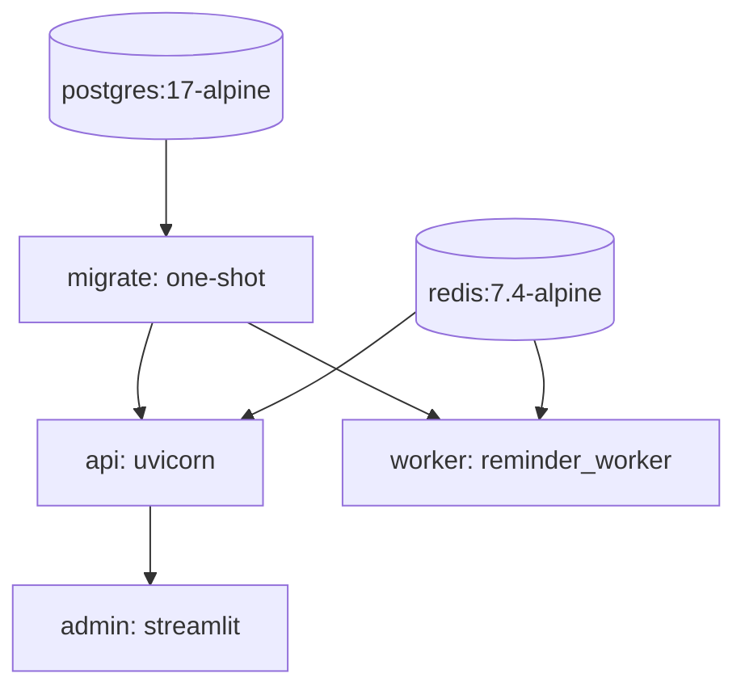

# Deploy via Docker Compose

`compose.yaml` na raiz orquestra 6 serviços.

## Serviços



| Serviço | Container | Porta host | Healthcheck |
|---------|-----------|-----------|-------------|
| `postgres` | `project_wapp_postgres` | `5432` | `pg_isready` |
| `redis` | `project_wapp_redis` | — | `redis-cli ping` |
| `migrate` | `project_wapp_migrate` | — | Termina após aplicar/verificar 37 migrações. |
| `api` | `project_wapp_api` | `8000` | `urllib /health/ready` |
| `worker` | `project_wapp_worker` | — | `python -m app.tools.reminder_worker --validate-only` |
| `admin` | `project_wapp_admin` | `8501` | `urllib /_stcore/health` |

`api` e `worker` esperam PostgreSQL/Redis saudáveis e
`migrate: service_completed_successfully`. Ambos usam
`RUN_MIGRATIONS_ON_STARTUP=false`.

## Volumes

- `postgres_data` — dados do banco.
- `redis_data` — AOF do estado compartilhado.
- `backups_data` — `/app/backups` (export_runtime_backup).

## Subir

```bash
docker compose --env-file .env.production up --build -d
```

Verificar:

```bash
docker compose --env-file .env.production ps
docker compose --env-file .env.production logs -f api
```

Antes do primeiro start, substitua todos os defaults de credencial do Compose.
Em produção use serviços gerenciados; o arquivo é principalmente referência e
ambiente de staging/autohost.

## Subir só Postgres

Quando você quer rodar API/worker no host:

```bash
docker compose --env-file .env.production up -d postgres
```

## Variáveis "compose-only"

Quando o app roda **dentro** do compose, o host do Postgres é `postgres` (nome do serviço), não `127.0.0.1`. Por isso existem variáveis distintas:

| Variável | Uso |
|----------|-----|
| `DATABASE_URL` | Conexão default no host (fora do compose). |
| `POSTGRES_DATABASE_URL` | Probe explícito de Postgres. |
| `COMPOSE_DATABASE_URL` | Conexão dentro do compose (`@postgres:5432`). |
| `COMPOSE_POSTGRES_DATABASE_URL` | Probe dentro do compose. |
| `COMPOSE_REDIS_URL` | Redis dentro do compose (`redis://redis:6379/0`). |

`compose.yaml` injeta `DATABASE_URL=${COMPOSE_DATABASE_URL:-...}` dentro dos containers.

## Pré-flight dentro do container

```bash
docker compose --env-file .env.production exec api \
  python -m app.tools.preflight_check --require-scale-ready
```

## Rebuild

```bash
docker compose --env-file .env.production up --build -d api worker admin
```

## Logs estruturados

`LOG_JSON=true` por default. Coletar via stdout dos containers (`docker logs` ou plataforma de logs).

## Healthchecks

| Serviço | Comando | Quando passa |
|---------|---------|--------------|
| postgres | `pg_isready -U $POSTGRES_USER` | Banco aceita conexões. |
| redis | `redis-cli ping` | Estado compartilhado disponível. |
| migrate | comando one-shot | Schema está atual e processo termina com zero. |
| api | `urllib.urlopen('/health/ready')` | Banco OK + sem blockers. |
| worker | `python -m app.tools.reminder_worker --validate-only` | Conecta no banco e configura logger. |
| admin | `urllib.urlopen('/_stcore/health')` na porta 8501 | Servidor Streamlit responde. |

Falhas da API/worker/admin → restart automático (`restart: unless-stopped`).
`migrate` usa `restart: "no"` para não esconder erro de release.

O comando `--validate-only` fecha explicitamente o pool PostgreSQL antes de
terminar. Isso evita que o processo do healthcheck fique preso por threads do
pool mesmo depois de a validação ter concluído.

## Próximas leituras

- [[60-Operations/02-Configuração de Ambiente]]
- [[60-Operations/04-Healthchecks e Readiness]]
- [[60-Operations/06-Runbook Produção]]
