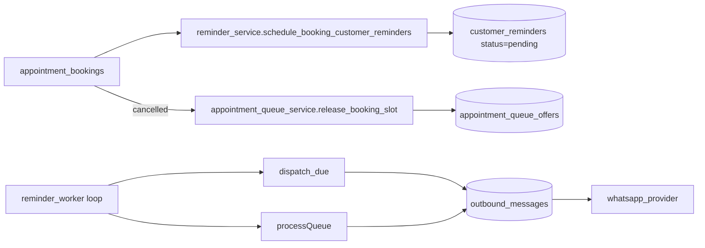

# Worker de Lembretes

`app/tools/reminder_worker.py`. Container dedicado em `compose.yaml:111`.

## Loop

1. Lê `REMINDER_WORKER_POLL_SECONDS` (default 60s).
2. Para cada audience em `REMINDER_WORKER_AUDIENCES` (default `customer,internal`):
   - `reminder_service.dispatch_due_reminders(audience, channel=...)`.
   - Materializa lembretes vencidos em `outbound_messages` e dispara conforme `REMINDER_WORKER_DISPATCH_IMMEDIATELY`.
3. Processa fila de remanejamento:
   - `appointment_queue_service.process_*` para follow-ups e expiração de janelas de resposta.

## Configuração

| Env | Default | Função |
|-----|---------|--------|
| `REMINDER_WORKER_ENABLED` | `false` em código, `true` em compose | gate |
| `REMINDER_WORKER_POLL_SECONDS` | `60` | intervalo |
| `REMINDER_WORKER_DISPATCH_IMMEDIATELY` | `true` | manda outbound já no mesmo ciclo |
| `REMINDER_WORKER_CHANNEL` | `""` | canal default; vazio = `OUTBOUND_DEFAULT_CHANNEL` |
| `REMINDER_WORKER_AUDIENCES` | `customer,internal` | quais públicos processar |
| `APPOINTMENT_QUEUE_AUTO_DISPATCH` | `true` | auto-criar ofertas após cancelamento |
| `APPOINTMENT_QUEUE_RESPONSE_WINDOW_MINUTES` | `30` | TTL da oferta |
| `APPOINTMENT_QUEUE_WAIT_FOLLOWUP_MINUTES` | `30` | Tempo até follow-up de "estou avaliando" |

## Modo validate-only

```bash
python -m app.tools.reminder_worker --validate-only
```

Usado pelo healthcheck. Conecta no banco, valida configuração e sai com `0` se OK.

## Como age



## Operação

```bash
# logs do worker
docker compose --env-file .env.production logs -f worker

# disparo manual via API (para testes)
curl -X POST -H "Authorization: Bearer $TOKEN" \
  "http://api:8000/admin/reminders/dispatch-due?audience=customer"
```

## Riscos / atenção

- **Single-instance** — múltiplos workers podem dispatcher em duplicidade. Hoje recomenda-se 1 réplica.
- **Sem retry com backoff** — falhas no provider são registradas em `outbound_messages.status=failed`, mas o worker não retenta.
- **Sem dead letter** explícita.

Tracking em [[80-Improvements/02-Issues Identificados]].

## Próximas leituras

- [[10-Architecture/06-Fluxo Agenda]]
- [[20-Modules/09-Workers e Tools]]
