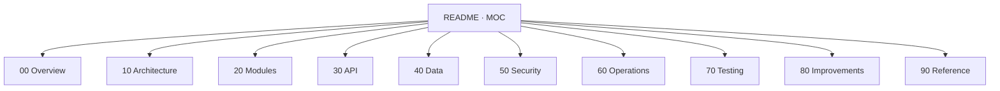

# Project WAPP — Vault de Conhecimento

> **Map of Content (MOC) raiz.** Este vault Obsidian consolida tudo que é necessário para entender, operar, evoluir e auditar o backend de atendimento conversacional **Project WAPP** (FastAPI + Postgres/SQLite + OpenAI + WhatsApp Cloud API).
>
> Use este arquivo como ponto de entrada. Cada link `[[...]]` abre uma nota dedicada.

## 🎯 Propósito do produto

Backend conversacional multiempresa que recebe mensagens (WhatsApp ou genéricas), classifica intenção, decide responder automaticamente ou criar handoff humano, gerencia agenda/lembretes/fila de remanejamento e prepara dataset para fine-tuning.

Detalhe completo em [[00-Overview/01-Visão Geral]].

## 🗺️ Como navegar

## 📚 Índice por área

### 00 — Overview
- [[00-Overview/01-Visão Geral]]
- [[00-Overview/02-Glossário]]
- [[00-Overview/03-Estado Atual do Produto]]
- [[00-Overview/04-Roadmap e Próximos Passos]]

### 10 — Architecture
- [[10-Architecture/01-Arquitetura em Camadas]]
- [[10-Architecture/02-Diagrama de Componentes]]
- [[10-Architecture/03-Fluxo Mensagem Recebida]]
- [[10-Architecture/04-Fluxo Handoff]]
- [[10-Architecture/05-Fluxo Outbound]]
- [[10-Architecture/06-Fluxo Agenda]]
- [[10-Architecture/07-Fluxo Fine-Tuning]]

### 20 — Modules
- [[20-Modules/01-Core]]
- [[20-Modules/02-API Pública]]
- [[20-Modules/03-API Admin]]
- [[20-Modules/04-Plataforma Frontend]]
- [[20-Modules/05-Services]]
- [[20-Modules/06-LLM Providers]]
- [[20-Modules/07-Storage e Repository]]
- [[20-Modules/08-UI Streamlit]]
- [[20-Modules/09-Workers e Tools]]

### 30 — API
- [[30-API/01-Endpoints Públicos]]
- [[30-API/02-Endpoints Admin]]
- [[30-API/03-Webhook WhatsApp]]
- [[30-API/04-Auth e Sessão Web]]
- [[30-API/05-RBAC e Papéis]]

### 40 — Data
- [[40-Data/01-Modelo de Dados]]
- [[40-Data/02-Schema do Banco]]
- [[40-Data/03-Migrações]]
- [[40-Data/04-Multi-tenant]]
- [[40-Data/05-Company Context]]
- [[40-Data/06-Backup e Limpeza]]

### 50 — Security
- [[50-Security/01-Modelo de Ameaças]]
- [[50-Security/02-Auth Admin]]
- [[50-Security/03-Webhook HMAC]]
- [[50-Security/04-Rate Limiting]]
- [[50-Security/05-Secrets e Ambiente]]
- [[50-Security/06-PII e Dataset]]
- [[50-Security/07-Auditoria]]
- [[50-Security/08-Hardening Operacional]]

### 60 — Operations
- [[60-Operations/01-Deploy Docker Compose]]
- [[60-Operations/02-Configuração de Ambiente]]
- [[60-Operations/03-Observabilidade]]
- [[60-Operations/04-Healthchecks e Readiness]]
- [[60-Operations/05-Worker de Lembretes]]
- [[60-Operations/06-Runbook Produção]]
- [[60-Operations/07-Provider WhatsApp Real]]
- [[60-Operations/08-Billing e Planos]]

### 70 — Testing
- [[70-Testing/01-Estratégia de Testes]]
- [[70-Testing/02-Catálogo de Testes]]

### 80 — Improvements
- [[80-Improvements/01-Limites Conhecidos]]
- [[80-Improvements/02-Issues Identificados]]
- [[80-Improvements/03-Melhorias de Segurança]]
- [[80-Improvements/04-Melhorias de Escalabilidade]]
- [[80-Improvements/05-Backlog de Produto]]

### 90 — Reference
- [[90-Reference/01-Variáveis de Ambiente]]
- [[90-Reference/02-Comandos Úteis]]
- [[90-Reference/03-Mapa de Arquivos]]

## 🚦 Estado em uma página

| Dimensão | Estado | Nota |
|----------|--------|------|
| Backend conversacional | ✅ Maduro | Orquestrador, classificação, reply, memória, pipeline. |
| Multi-tenant | ✅ Implementado | `company_id`/`company_slug` em todas tabelas operacionais. |
| Agenda + lembretes | ✅ Operacional | Provider mock + preparação Google/CalDAV. |
| Fine-tuning | 🟡 Pipeline pronto | Falta job concluído com sucesso em produção. |
| WhatsApp real | 🟡 Preparado | HMAC validado, falta hardening produtivo. |
| RBAC | ✅ Por token | Evolução para identidade centralizada pendente. |
| Tracing distribuído | 🔴 Ausente | Apenas logs JSON + `X-Request-ID`. |
| Identidade humana | 🔴 Ausente | Tokens estáticos por papel. |

Detalhamento em [[00-Overview/03-Estado Atual do Produto]] e [[80-Improvements/01-Limites Conhecidos]].

## 🧭 Atalhos por persona

- **Onboarding de nova IA/sessão Claude** → começar por [[00-Overview/01-Visão Geral]] → [[10-Architecture/01-Arquitetura em Camadas]] → [[90-Reference/03-Mapa de Arquivos]].
- **Engenharia (mudar comportamento)** → [[20-Modules/05-Services]] e [[10-Architecture/03-Fluxo Mensagem Recebida]].
- **Operação (incidente / deploy)** → [[60-Operations/06-Runbook Produção]].
- **Segurança / auditoria** → [[50-Security/01-Modelo de Ameaças]].
- **Produto / roadmap** → [[80-Improvements/05-Backlog de Produto]].

## 🔁 Convenções deste vault

- Pastas numeradas (`00-`, `10-`, ...) para ordem estável e independência de plugin.
- Frontmatter YAML em **toda** nota com `title`, `type`, `tags`, `updated`.
- Links internos sempre `[[pasta/nota|alias opcional]]`.
- Citações de código com caminho relativo ao repositório, ex.: `app/core/orchestrator.py:269`.
- Datas absolutas (ISO `YYYY-MM-DD`).
- Sempre cruzar mudança de código com a nota correspondente — caso contrário a nota fica obsoleta.

## 🔗 Referências externas do projeto

- `README.md` (raiz do repo) — guia de instalação/operação.
- `docs/architecture.md`, `docs/api_spec.md`, `docs/codebase_map.md`, `docs/platform_frontend_guide.md`, `docs/production_runbook.md`.
- `compose.yaml`, `Dockerfile`, `.env.example`.
