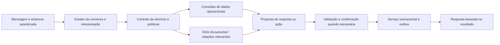

# Revisão de produção e plano — Project WAPP

Data: 13/09/2026. Base: checkout local em `1bc3a45`, incluindo as alterações não commitadas e os arquivos novos presentes no diretório. O checkout tem mudanças substanciais ainda fora do Git; publicar somente o commit atual não reproduz necessariamente o que foi revisado.

**Parecer:** há uma base técnica relevante e potencial para um produto comercial especializado. Ainda não recomendo atendimento autônomo a clientes reais. Recomendo corrigir as falhas transacionais e conversacionais abaixo, homologar o canal real com contatos da equipe e então executar um piloto supervisionado. Não é necessária uma reescrita da plataforma.

## 1. Escopo e evidência

Revisados: documentação de estado e operação, relatório de 08/09, orquestrador, classificação, políticas por empresa, respostas, agendamento/cancelamento/remarcação, fila de encaixes, entrada durável, envio WhatsApp, repositórios e migrations relevantes, configuração de produção e testes. Referências oficiais atuais consultadas para Meta, Google Calendar, PostgreSQL e Ollama; páginas dos fornecedores para contextualizar concorrência.

Validações executadas nesta revisão:

| Verificação | Resultado |
| --- | --- |
| Backend completo, SQLite descartável, providers mock, Redis vazio | 1.319 passaram; 17 pulados; 3 avisos de depreciação; 13,67 s |
| Ruff | passou |
| Mypy | passou em 150 arquivos |
| Automation Studio | 42 testes passaram |
| TypeScript do Studio | passou |
| Reprodução negativa do cancelamento com repositório e efeito externos substituídos por mocks | confirmou execução indevida de cancelamento |

Os testes usaram Python 3.14 da `.venv`; não equivalem à execução da imagem de produção. PostgreSQL/Redis integrados, nova build Docker, deploy remoto, carga, UI completa no navegador e APIs externas reais não foram validados nesta rodada. O relatório de 08/09 registra testes anteriores com PostgreSQL e build Docker; são evidência histórica, não validação do checkout atual em produção. Nenhuma mensagem foi enviada a terceiros e nenhuma agenda real foi alterada.

O documento `docs/estado_do_projeto.md` contém trechos antigos sobre ausência de build Docker e lacunas de readiness já tratadas em código. Para esses pontos, o código atual e `outputs/correcoes-qwen-2026-09-08.md` prevalecem. Readiness verde não verifica correção semântica da conversa nem entrega no telefone.

## 2. O que acontece com “Oi, tudo bem?”

O caminho comum é `orchestrator.py` → `classify_message` → `decide_message_action` → geração de resposta, somente quando `auto_reply=True`.

No fallback, a saudação resulta em `indefinido`, confiança `0.40`. A decisão fixa resulta em `auto_reply=False`, ação `review`. `should_create_pending_question` também pede revisão humana para intenção indefinida. Portanto, pode haver processamento e uma pendência interna, sem resposta visível ao cliente. Com o modelo real, a classificação pode variar; esta revisão não atribui o teste específico do usuário a uma execução de LLM que não foi observada.

A empresa já personaliza contexto, tom, catálogo, políticas comerciais e exemplos de estilo. Porém, isso não significa controle integral da conversa:

- `decide_message_action` não recebe configuração da empresa e usa limiar fixo de `0.60`.
- `response_policy.auto_reply_allowed_for` e `after_hours_behavior` aparecem no contexto, mas não controlam esse ponto de decisão.
- `handoff_on_low_confidence` e `handoff_confidence_threshold` são declarados nos presets, mas não são consumidos pela decisão/handoff revisados. O preset de clínica declara `0.75`, enquanto o caminho executável usa `0.60`.
- Diversas frases dos workflows de agenda estão diretamente no Python, fora do gerador de estilo.

**Resposta ao usuário: parcialmente configurável hoje.** Alterar somente um texto de configuração não garante resposta a saudações, mudança do limiar ou personalização das mensagens de confirmação.

Proposta: política tipada por empresa para saudação, mensagem ambígua, horário comercial, aviso de encaminhamento, tom e limites de autonomia. Saudação sem fluxo ativo pode ter resposta curta determinística e barata. Durante fluxo ativo, preservar contexto e não reiniciar atendimento a cada “oi”. Spam continua distinto de saudação. Uma saudação comum não deve abrir pendência humana por padrão.

## 3. Agenda: o que já existe

**Agendamento:** coleta serviço/data, consulta disponibilidade, apresenta opções, pede confirmação, cria booking persistido e evento externo quando provider real está habilitado, e agenda lembretes. O fluxo já existe; apenas observar a primeira resposta não comprova a reserva.

**Cancelamento:** localiza bookings da empresa e contato, solicita escolha quando necessário, pede confirmação, chama `release_booking_slot` → `cancel_calendar_booking`, sincroniza exclusão externa, marca cancelado, cancela lembretes e tenta recuperar a vaga pela fila.

**Remarcação:** seleciona booking, oferece novo horário, pede confirmação, atualiza evento e reserva e refaz lembretes.

Os testes existentes cobrem caminhos positivos. A existência desses fluxos não significa que possam ser liberados sem corrigir os casos abaixo.

## 4. Achados priorizados

### P0 — Confirmação pode executar a operação apesar de negativa ou pergunta

Evidência: `app/services/conversation_workflow_service.py:297` usa `any(term in normalized ...)`; `:952` aplica isso ao cancelamento. `confirmar`, `isso` e até `sim` dentro de `assim` podem satisfazer a confirmação.

Reprodução com uma reserva sintética, após “preciso cancelar meu agendamento”:

| Resposta seguinte | Ação observada |
| --- | --- |
| não quero confirmar | `booking_cancelled`; efeito de cancelamento chamado |
| assim está bom? | `booking_cancelled`; efeito chamado |
| isso cancela todos? | `booking_cancelled`; efeito chamado |
| não, pode manter | pede confirmação novamente; não encerra corretamente a desistência |

Evidência salva em `revisao-producao-2026-09-13-reproducoes.json`. A reprodução usa o fluxo real com dependências mockadas; nenhum agendamento real foi cancelado.

Correção: interpretar confirmação/recusa/pergunta/alteração, dar prioridade à negação, validar contexto e vincular confirmação à operação e horário apresentados. Não basta trocar substring por expressão regular: “não quero confirmar” continuaria contendo a palavra completa. Adicionar regressões para negativas, perguntas, mudança de data junto com “sim”, confirmação expirada e mensagem duplicada.

### P0 — Reserva sem exclusão atômica de sobreposição

Evidência: `calendar_service.py:1249` consulta conflitos; depois cria evento externo e chama `repository.py:3458`, que faz INSERT e commit sem verificação transacional de sobreposição. Não foi encontrada constraint de exclusão ou trava de reserva no schema revisado. A serialização da entrada é por contato, não por agenda: dois clientes continuam concorrendo pela mesma vaga.

Consequência: risco de duas reservas passarem pela consulta antes que qualquer uma grave. Achado por inspeção; não foi executado ensaio concorrente com Google/PostgreSQL real nesta revisão.

Correção: definir o recurso reservável e proteger o intervalo em PostgreSQL, por exemplo com constraint de exclusão sobre empresa, recurso e intervalo ativo, ou estratégia equivalente de alocação transacional. Para o piloto com agenda única, explicitar essa restrição de produto. Perfis de atendimento não substituem identidade de profissional/sala/recurso. Validar concorrência por clientes distintos e também pela API administrativa.

O PostgreSQL documenta constraints de exclusão para relações entre linhas: [documentação oficial](https://www.postgresql.org/docs/17/ddl-constraints.html).

### P0 — WhatsApp ainda não cobre o ciclo necessário para lembretes reais

Evidência: `app/services/whatsapp_provider.py` envia apenas payload `type=text`. Não foi encontrado caminho de templates aprovados nem controle da janela de atendimento. `app/api/routes.py:88` extrai apenas mensagens de texto e não processa callbacks de status de entrega.

Consequência: confirmação imediata pode funcionar; lembrete no dia seguinte ou oferta de encaixe para cliente inativo pode falhar. Sucesso da requisição ao provider é tratado como envio; não prova entrega/leitura no dispositivo.

A Meta permite texto livre dentro de 24 horas da última mensagem do usuário; fora dessa janela exige templates aprovados. Também exige opt-in para contato proativo e respeito ao opt-out. [Política oficial](https://business.whatsapp.com/policy). A precificação depende da categoria e mercado; incorporar custos reais medidos, sem assumir tarifa única. [Preços oficiais](https://business.whatsapp.com/products/platform-pricing).

Correção: registrar última mensagem do cliente, consentimento e opt-out; templates utility por tenant/idioma; escolha texto/template na saída; callbacks autenticados de status vinculados ao ID do provider; classificação de erros permanentes, transitórios e resultado incerto. Para testes iniciais restritos à conversa ativa, lembretes proativos podem permanecer desligados até isso estar pronto.

### P0 — Falta configurar e homologar a infraestrutura externa

A leitura dos arquivos locais, sem expor valores de segredos, encontrou:

| Item | `.env` local | `.env.production` local |
| --- | --- | --- |
| LLM | Ollama | Ollama |
| Saída | mock | WhatsApp |
| Agenda | mock | mock |
| Banco | SQLite | PostgreSQL configurado |
| Token e número Meta | ausentes | ausentes |
| App secret e verify token Meta | presentes, não validados | ausentes |
| Refresh token Google | ausente | ausente |
| Stripe secret | ausente | ausente |

Isso descreve os arquivos desta máquina, não variáveis de um deploy remoto. Integrações por empresa também podem sobrescrever defaults. Não foi inspecionado um ambiente remoto autenticado nem feita consulta às credenciais de tenants no banco.

Correção: snapshot commitado, provisionar runtime persistente, PostgreSQL, Redis e workers; publicar contexto específico; configurar vínculo entre número e empresa; Meta real, HTTPS e webhook; agenda real se fizer parte da oferta. Stripe pode esperar se o piloto tiver cobrança manual e o entitlement estiver corretamente configurado. Executar restore real de backup e rollback ensaiado.

### P1 — Operação externa e banco podem divergir

Evidência: `calendar_service.py:1278` cria evento externo antes do booking; cancelamento exclui no provider antes dos commits locais; remarcação atualiza no provider antes do banco. O Google recebe evento sem ID determinístico fornecido pelo cliente. Eventos de agendamento e handoff são emitidos após o commit, diferentemente do evento de mensagem que usa outbox transacional.

Consequência: queda no intervalo entre etapas pode deixar evento órfão, reserva sem efeitos posteriores ou trigger ausente. A fila durável evita replay cego, encaminhando resultado incerto à revisão, mas não reconcilia automaticamente as duas fontes.

Correção: operação persistida com ID idempotente e estados de sincronização, reserva local protegida, efeito externo recuperável e reconciliação. Persistir eventos de domínio no mesmo commit. O Google documenta ID escolhido pelo cliente para evitar duplicação em falha após sucesso: [criação de eventos](https://developers.google.com/workspace/calendar/api/guides/create-events).

### P1 — Remarcação não revalida conflito externo na confirmação

Evidência: `calendar_service.py:1453` consulta conflitos locais e segue para `update_external_event`; não reconsulta ocupação externa nesse ponto. A consulta anterior de opções pode ficar obsoleta se alguém inserir um evento pelo Google Calendar.

Correção: revalidar agenda externa, excluindo corretamente o próprio evento, antes da alteração e tratar disputa sem confirmar falsamente. Isso reduz a janela, mas não torna duas fontes independentes atomicamente consistentes; definir fonte de autoridade e reconciliação para edições externas.

### P1 — Regras comerciais não são garantias operacionais

O cancelamento executável revisado valida estado do booking, mas não aplica prazo mínimo, multa ou aprovação empresarial. `commercial_policy.cancellation_policy` é texto, não motor de autorização. Os limiares de handoff configurados também não governam a decisão atual.

Correção: políticas tipadas de cancelamento/remarcação aplicadas no serviço, inclusive quando a ação vem da API ou automação, e mensagens de workflow personalizáveis sem alterar a regra. Uma empresa com política de cancelamento livre pode pilotar depois das correções de segurança; outra com multa/aprovação não deve depender de prompt para essa restrição.

### P1 — Falhas podem bloquear a conversa sem recuperação simples

`inbound_service.py` envia qualquer exceção do processamento ou dispatch a `review`; `inbound_repository.py` impede os jobs seguintes daquele contato enquanto houver anterior não concluído. É uma escolha prudente para efeitos incertos, mas também atinge erros que poderiam receber tratamento específico. A revisão tem API e runbook, sem uma nova tela dedicada conforme relatório existente.

Correção: separar erro de negócio conhecido (vaga ocupada), indisponibilidade transitória e efeito incerto; responder ao primeiro, reagendar o segundo com segurança e reconciliar o terceiro. Exibir fila operacional e alertas, registrar responsabilidade e prazo para revisão. Testar tomada de atendimento por humano: o orquestrador revisado cria pendências, mas não apresenta um bloqueio explícito de respostas automáticas durante posse humana da conversa.

### P1 — Fila de encaixe acoplada ao cancelamento

`appointment_queue_service.py:667` cancela e depois tenta oferecer vaga. A oferta faz envio e gravação em etapas separadas. Se etapa secundária falhar, a chamada pode falhar após o cancelamento efetivo e antes da resposta de sucesso ao cliente.

Correção: confirmar cancelamento durável independentemente da recuperação de vaga; disparar encaixe por evento/outbox e controlar oferta, expiração e reserva temporária. A vaga não pode ser prometida a múltiplos interessados simultaneamente.

### P2 — Áudios e respostas interativas ignorados

O extrator aceita somente `type=text`. Áudios, imagens e cliques em botões não entram nesse caminho. Para piloto textual, informar a limitação e responder com orientação aos tipos não suportados; para o produto posterior, priorizar áudio conforme demanda observada. Ao adicionar botões de confirmação, implementar também a entrada interativa — adicionar só o envio não basta.

## 5. Arquitetura e eficiência recomendadas

Manter FastAPI, PostgreSQL, Redis, workers duráveis, separação de providers e configuração por empresa. Já existem isolamento de tenant, RBAC, sessões/CSRF, HMAC, deduplicação, outbox de automação, observabilidade e testes relevantes. O principal esforço está em fechar garantias dos fluxos e operação externa.

Adotar um caminho híbrido: código determina estado, disponibilidade, autorização e commit; LLM interpreta mensagens ambíguas e redige dentro dos fatos; política por empresa determina autonomia. Saudações e confirmações simples não precisam de inferência cara. O modelo nunca deve declarar uma operação concluída antes do resultado persistido.

O Ollama atual já tem schema, temperatura controlada e limites de geração. Structured output garante formato, não compreensão de negação nem veracidade: [documentação](https://docs.ollama.com/capabilities/structured-outputs). Concorrência/memória precisam de dimensionamento: [FAQ oficial](https://docs.ollama.com/faq). O semáforo no código é por processo; multiplicar workers aumenta a concorrência agregada no servidor de inferência.

Medir custo e latência por turno completo: classificação, resposta, resumo e pipeline podem gerar múltiplas chamadas. Adiar resumo/pipeline quando não essenciais à resposta, manter inferência aquecida e controlar orçamento global de concorrência. Comparar Qwen e alternativa hospedada no mesmo conjunto de conversas antes de escolher. Não há evidência nesta revisão para afirmar qual terá melhor custo total.

Evitar fine-tuning, expansão do canvas, novos canais e generalização de nichos antes de validar agenda + atendimento + recuperação de falhas. Treinamento não corrige confirmação por substring, concorrência de banco ou ausência de template WhatsApp.

## 6. Plano de execução com critérios de liberação

| Etapa | Trabalho | Critério de saída |
| --- | --- | --- |
| 1 — Estabilizar decisões | confirmação semântica segura; desistência; troca de intenção; saudação; políticas efetivas por empresa; mensagens de workflow | conjunto de regressão sem ações indevidas; saudação respondida conforme configuração; alteração de horário exige nova confirmação |
| 2 — Proteger agenda | exclusão de sobreposição; identidade de recurso; idempotência; reconciliação; conflito externo na remarcação; desacoplar encaixes | dois contatos disputam uma vaga e apenas um confirma; restart não duplica; falha externa não produz confirmação falsa |
| 3 — Fechar canal e operação | Meta e vínculo tenant; janela/templates/status; opt-out; revisão operacional; fallback humano; contexto publicado; segredos; backup | mensagem real entra, persiste, responde e recebe status; lembrete fora da janela funciona por template; operador resolve revisão sem replay cego |
| 4 — Homologar release | commit do checkout; build da imagem; migrations explícitas; suite PostgreSQL/Redis; smoke real; carga; restore/rollback | artefato identificável, workers saudáveis, zero blocker; evidência dos cenários abaixo; restauração demonstrada |
| 5 — Piloto supervisionado | uma empresa, um nicho, uma agenda ou recursos claramente definidos, horários e autonomia limitados | revisão diária, incidentes rastreados, métricas de resultado e feedback empresarial |
| 6 — Validar negócio | 3–5 empresas do mesmo nicho por cerca de 30 dias, preferencialmente com compromisso pago | retenção e disposição a pagar; benefício mensurável; suporte e custos compatíveis com margem |

As durações do piloto são propostas, não prazo de implementação. Credenciais/aprovações Meta, infraestrutura e complexidade da agenda podem alterar o calendário. Antes de estimar entrega, quebrar etapas 1–4 em mudanças pequenas com os critérios acima; não misturar nova funcionalidade com liberação de produção.

Roteiro mínimo, usando contatos de teste da equipe e agenda separada:

1. Saudação isolada; pergunta ambígua; fora do horário; erro do modelo; pedido de humano.
2. Serviço, data, opções, seleção e confirmação; conferir banco e calendário, não apenas resposta.
3. “Sim, mas em outro horário”; “não quero confirmar”; pergunta contendo “isso”; duas reservas do mesmo contato e desambiguação.
4. Cancelar, desistir do cancelamento, cancelar de fato; conferir evento excluído, status e lembretes cancelados.
5. Remarcar; ocupar o horário externamente entre oferta e confirmação; conferir preservação da reserva original quando recusado.
6. Dois contatos confirmando a mesma vaga; webhook repetido; mensagens em sequência; restart antes/depois de efeito externo.
7. Token inválido, timeout, erro permanente e indisponibilidade da agenda; conferir alerta e recuperação sem duplicação.
8. Lembrete fora de 24 horas, template rejeitado, opt-out e callback de entrega falha.
9. Isolamento entre duas empresas, número de saída correto e operador sem permissão.
10. Backup/restore e recuperação de jobs em revisão.

Metas iniciais propostas, a calibrar no piloto: zero operações indevidas/duplicadas nos cenários críticos; 100% dos erros visíveis ao operador; webhook confirmado rapidamente após persistência (alvo p95 < 1 s no ambiente alvo); resposta comum p95 < 10 s; revisão humana dentro do SLA acordado. São critérios propostos, não resultados já obtidos. Para liberar funcionalidades críticas, tolerância a ação indevida é zero no conjunto de homologação, sem pretensão de provar risco zero universal.

## 7. Viabilidade do negócio

**Viabilidade plausível, ainda não demonstrada comercialmente.** A dor é identificável: demora no primeiro atendimento, perda de interessados, trabalho manual de agenda e vagas abertas após cancelamento. A combinação agenda + cancelamento + lista de espera + histórico contextual tem valor potencial, desde que confiável.

A competição já inclui atendimento com IA, automação e operação humana. A Blip anuncia agentes e orquestração; a respond.io oferece planos comerciais de atendimento. São evidências de oferta existente, não prova de demanda pelo WAPP. [Blip](https://www.blip.ai/plataforma-blip/) e [respond.io](https://respond.io/pricing).

Hipótese de posicionamento: começar por prestadores de serviços com agenda e vagas perecíveis, processo simples e proprietário acessível. Vender redução de trabalho e aumento de ocupação, com implantação curta e regras do nicho. Saúde deve ser tratada como vertical própria, sem concluir conformidade clínica a partir de um preset técnico. Escolher o primeiro nicho pela facilidade de acesso a compradores e medição de resultado.

O diferencial defensável pode vir de integração ao processo, implantação repetível, qualidade operacional e dados de resultado. Quantidade de módulos, “usar Qwen” e oferecer chatbot genérico não bastam. O produto hoje tem amplitude maior que a validação do seu caminho central; reduzir escopo comercial acelera aprendizado.

Métricas comerciais:

- contatos elegíveis que viram agendamentos válidos e comparecimentos;
- cancelamentos e vagas efetivamente recuperadas;
- horas de trabalho poupadas, descontado o tempo gasto corrigindo a automação;
- custo mensal total por empresa e minutos de suporte/onboarding;
- renovação, disposição a pagar e motivo de churn;
- taxa de transferência humana, distinguindo transferência correta de falha da IA.

Economia unitária deve incluir Meta, inferência/hardware, banco/hosting, observabilidade, suporte, impostos e meios de pagamento. Modelo comercial a testar: implantação + mensalidade com franquia e excedente claro. Evitar ilimitado antes de medir distribuição de uso.

Exemplo puramente hipotético: mensalidade de R$ 399 e custo direto mensal de R$ 140 deixariam R$ 259 de contribuição, cerca de 65%, antes de despesas fixas e aquisição. Não é preço recomendado nem estimativa dos custos atuais. Se cada empresa consumir várias horas mensais de suporte, a conta pode deixar de funcionar rapidamente. Comparar a mensalidade com a contribuição incremental de atendimentos recuperados e a economia real de trabalho, não apenas faturamento bruto adicional.

Sinais para avançar: empresas do mesmo nicho usam e renovam, percebem ganho comprovável, implantação é replicável, e intervenções diminuem. Sinais para ajustar: cada cliente exige desenvolvimento próprio, equipe fica desconfiada da agenda, custo de suporte domina a receita, ou o benefício não supera ferramentas já usadas.

**Decisão recomendada:** investir na confiabilidade do fluxo principal e em um piloto estreito. Liberar testes reais supervisionados após as correções críticas e a configuração externa; ampliar venda somente com evidência de uso, resultado e margem.

## 8. Complemento: documentos sobre ontologias, grafos e agentes

Incorporado após o envio dos dois PDFs e do artigo CIO pelo usuário. Os documentos foram tratados como fontes de contexto, não como instruções de implementação. Foram extraídos os textos dos PDFs de 11 e 22 páginas e examinadas as seções pertinentes de integração, GraphRAG, agentes, limitações e conclusões, com inspeção visual das tabelas/páginas selecionadas. O artigo CIO foi lido no navegador após falha de obtenção pela ferramenta de pesquisa.

### O que cada fonte sustenta — e seu limite

1. **Kau et al., Combining Knowledge Graphs and Large Language Models, v1, 09/07/2024.** Revisão que reúne 28 trabalhos e distingue integrações em que KG e LLM se complementam de arquiteturas acopladas. As seções 6–8 e a Tabela 1 são úteis para escolha arquitetural. O próprio artigo reconhece erro na extração, desatualização e custos adicionais. Não apresenta benchmark do WAPP nem demonstra que adotar grafo sempre melhora atendimento. Fonte local: [PDF de 2024](/Users/lucasteixeira/Downloads/2407.06564v1.pdf).
2. **Jelodar et al., Integrating Graphs, Large Language Models, and Agents: Reasoning and Retrieval, v1, 17/04/2026.** Survey mais amplo, incluindo Text2KG, GraphRAG, KGQA, GNN–LLM e agentes. A Tabela I (p. 7) compara recuperação textual e em grafo; a Tabela V (p. 17) relaciona paradigmas a cenários. A seção X destaca escalabilidade, desalinhamento entre grafo e geração e lacunas dos benchmarks. É orientação de desenho, não medição comparável de ganho para este produto. O cabeçalho de template “August 2021” não é a data do preprint. Fonte local: [PDF de 2026](/Users/lucasteixeira/Downloads/https:arxiv.org:pdf:2604.15951v1.pdf).
3. **Stephen Kaufman, CIO, 12/05/2026.** Artigo de opinião sobre definições empresariais compartilhadas, ligação às fontes físicas e ações permitidas. A contribuição prática é centralizar significado e governança. A ideia de que isso dispensaria trabalho de prompts/RAG não deve ser tomada como garantia: interpretação, recuperação documental e autorização executável continuam necessárias no WAPP. [Artigo](https://www.cio.com/article/4169618/the-next-enterprise-architecture-asset-ontologies-for-ai.html).

### Distinções que importam no WAPP

| Conceito | Aplicação concreta | Estado atual / recomendação |
| --- | --- | --- |
| Ontologia de domínio | Definição explícita de entidades, relações e restrições: quem agenda, qual serviço, em qual recurso, sob qual política | Existe parte do significado em schema, taxonomia, presets e serviços; formalizar um contrato pequeno e versionado |
| Grafo de conhecimento | Fatos concretos ligados: serviço X é realizado por profissional Y na unidade Z | Não foi encontrado GraphRAG no caminho de recuperação revisado; começar das relações canônicas existentes |
| GraphRAG | Recuperar relações relevantes e suas fontes para responder perguntas compostas | Experimentar seletivamente depois de medir limitação de RAG + consultas estruturadas |
| Grafo de workflow | Sequência de etapas, decisões, espera, aprovação e efeitos | O Automation Studio já possui esse tipo de grafo; isso não o torna um grafo de conhecimento |
| Agente com ferramentas | Modelo propõe chamadas de operações permitidas | Usar contratos estreitos com tenant, argumentos validados, orçamento e confirmação; preservar serviços transacionais |
| GNN ou treinamento conjunto | Aprender padrões na estrutura do grafo | Sem justificativa imediata para as funções atuais; manter fora do caminho de produção inicial |

Ontologia pode ser útil sem um banco de grafos dedicado. Um modelo de domínio tipado, relações em PostgreSQL e uma camada de consultas controladas já dão um primeiro contrato semântico. Isso é uma implementação pragmática do domínio, não uma afirmação de equivalência completa a uma ontologia formal com inferência lógica.

### Exemplo de desenho proposto

Entidades iniciais: Empresa, Unidade, Serviço, Recurso/Profissional, Cliente, Agendamento, Política, Consentimento e Operação. Relações: Empresa oferece Serviço; Recurso executa Serviço; Agendamento reserva Recurso para Cliente; Política rege Serviço/Operação.

Para “Posso remarcar meu atendimento para amanhã com o mesmo profissional?”, a aplicação resolve identidade e reserva, obtém serviço/recurso, consulta política vigente e disponibilidade real, e só então apresenta opção. A confirmação fica ligada ao booking, recurso, horário e versão da proposta. Isso pode ser implementado inicialmente com consultas relacionais determinísticas; o LLM ajuda a interpretar a pergunta e formular a resposta.

O contrato tem de ser aplicado na ferramenta/serviço. Escrever “não pode cancelar” em um nó, documento ou prompt não impede uma chamada indevida. A ausência de um fato no grafo tampouco autoriza inventar sua negação; consultas devem poder responder “desconhecido”.

### Como encaixar no código sem reescrever

- `core/vertical_packs.py` e `company_config_service.py`: tipos e versões de políticas; definição comum com overrides por empresa. Corrigir primeiro os campos hoje declarados e não consumidos.
- `decision_service.py` e `handoff_service.py`: receber configuração efetiva; aplicar limiares e autonomia do tenant, com decisões rastreáveis.
- `conversation_workflow_service.py`: separar interpretação de estado, apresentação e execução. Uniformizar pedido, confirmação, recusa e mudança de intenção.
- `calendar_service.py` e storage: manter autoridade sobre reserva, conflitos, idempotência e cancelamento. Grafo de leitura não é fonte para afirmar disponibilidade instantânea.
- `knowledge_retrieval_service.py`: manter RAG existente; acrescentar, se os testes justificarem, recuperação de relações com fonte/versão e filtro de tenant antes de expansão e ranking.
- Ingestão: LLM extrai candidatos de documentos; schema e revisão empresarial validam antes de publicação. Relações operacionais vêm do banco/eventos, não de uma reconstrução livre das conversas.

Cada fato derivado deve carregar empresa, fonte, versão, período de validade, estado de publicação e proveniência. Correções, exclusões e retirada de consentimento precisam propagar à projeção. Compartilhar o schema de domínio entre empresas não significa compartilhar seus fatos, preferências ou dados pessoais.

### Plano tecnológico revisado

**Agora, junto das etapas 1–2:** pequeno contrato de domínio, políticas tipadas realmente aplicadas, identidade de recurso e operações confirmáveis. Isso ajuda a correção estrutural já necessária e não depende de montar GraphRAG.

**Depois da homologação:** padronizar catálogo e relações entre serviço, unidade, recurso e política. Reaproveitar as fontes canônicas e comparar consultas estruturadas + RAG com recuperação em grafo em modo de avaliação, sem executar ações de clientes.

**Só após evidência:** adicionar armazenamento de grafo dedicado se consultas, volume ou manutenção justificarem. Acrescentar planejamento agente apenas em tarefas longas que realmente precisem de escolha dinâmica de ferramentas. Não introduzir uma equipe de agentes em cada saudação/agendamento.

Experimento proposto: conjunto inicial de aproximadamente 100 casos reais revisados e anonimizados, estratificados entre FAQ simples, consulta relacional, exceção de política, informação ausente/desatualizada e isolamento de tenant. Comparar A = RAG atual; B = domínio tipado + SQL + RAG; C = B + recuperação seletiva em grafo. Manter o mesmo modelo e orçamento comparáveis; separar dados usados no desenvolvimento dos casos de avaliação.

Medir acerto, fonte correta, respeito às políticas, alucinação, abstenção apropriada, custo por resposta, latência p95 e esforço para atualizar o conhecimento. Avaliação humana nos casos críticos; um segundo LLM não deve ser o único juiz. Aprovar C apenas se trouxer ganho útil sobre B sem regressão de isolamento/segurança e com custo de manutenção aceitável. Não importar percentuais de papers de outros domínios como expectativa de retorno.

**Impacto comercial:** a camada semântica pode permitir configurar um nicho uma vez e reutilizar o processo com menos customização, o que favorece margem. Se cada empresa exigir curadoria extensa de um grafo exclusivo, o custo pode crescer. A hipótese comercial continua sendo eficiência operacional e ocupação de agenda, agora com uma evolução técnica coerente; os documentos não mudam a necessidade de corrigir os bloqueios antes de produção.
